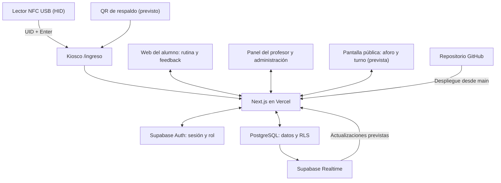
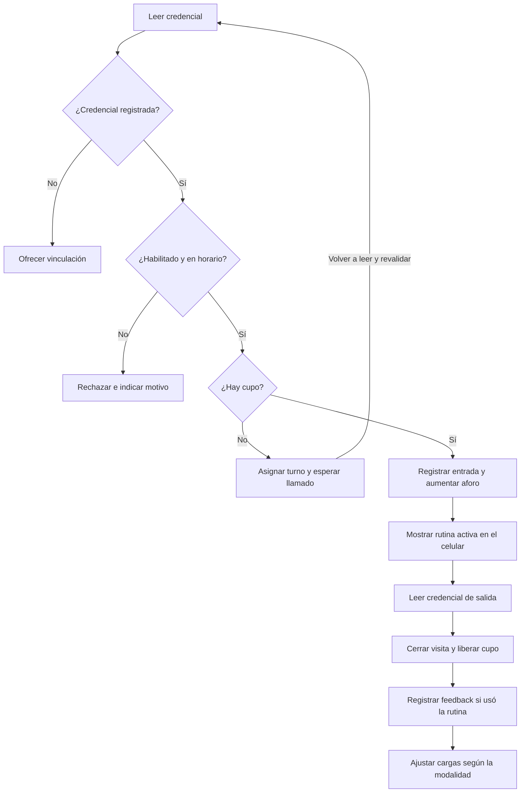
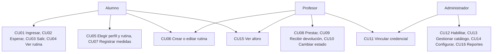
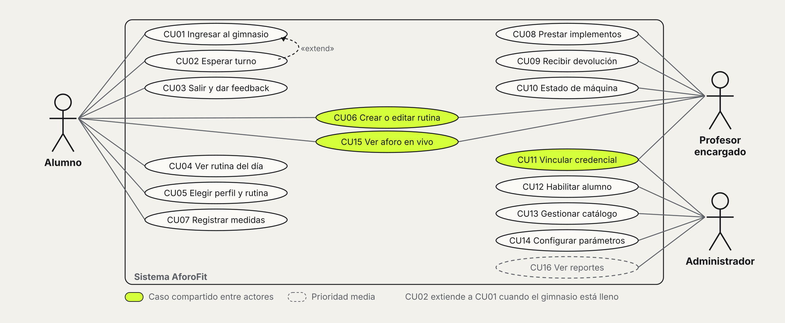
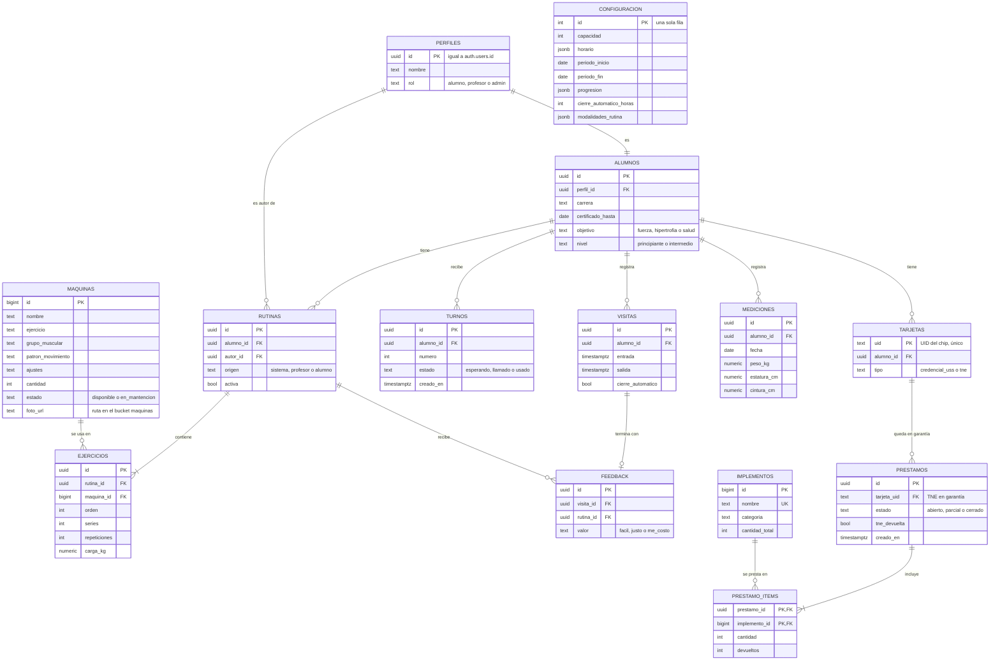
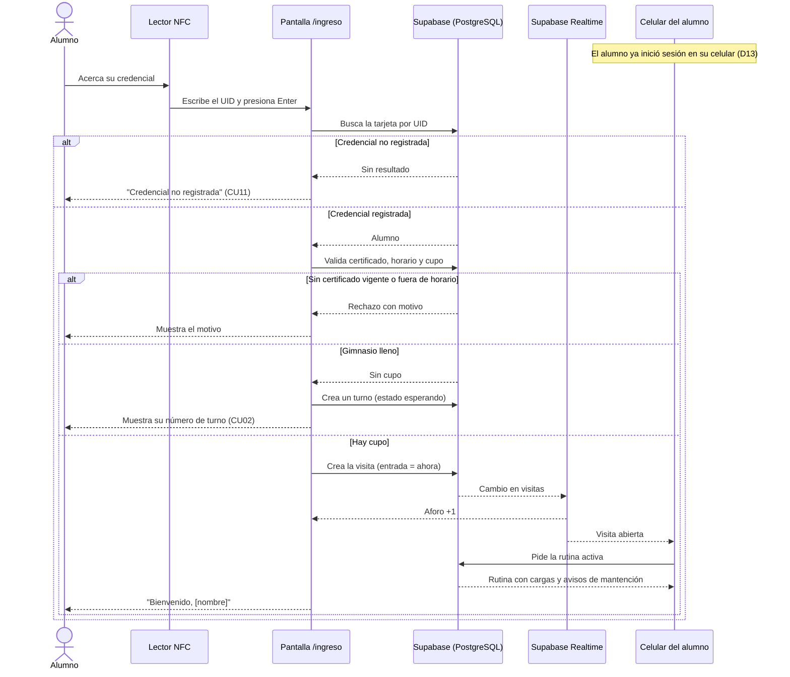
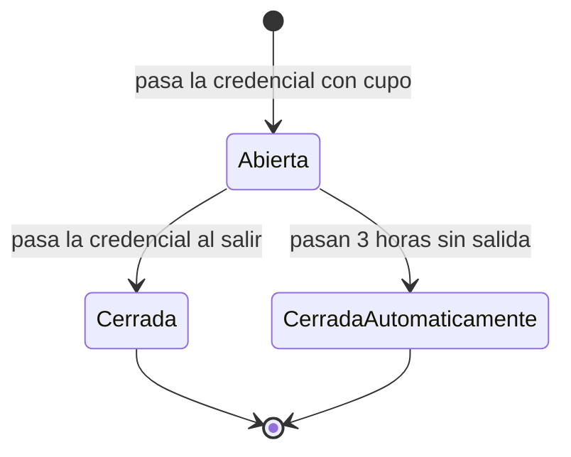
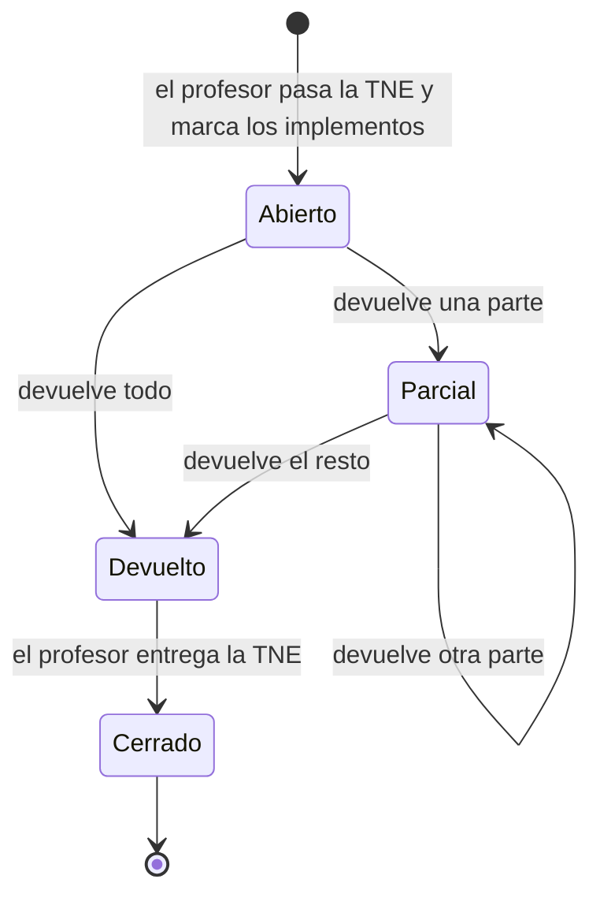

# AforoFit — Documento maestro al cierre del Avance 2

**Corte: 17 de noviembre de 2026.** El estado vigente está en [AGENTS.md, sección 10](../AGENTS.md#10-estado-actual), y lo construido para el Avance 3 en el [plan de cierre](plan-cierre-avance-3-y-final.md). Documento de continuidad para incorporar a una persona al equipo o dar contexto a una IA antes del Avance 3. Se lee en orden: propuesta original, análisis y diseño, evidencia técnica y trabajo siguiente.

Los avances 1 y 2 obtuvieron **7,0**, según el registro del equipo. La [pauta docente](bases-proyecto-integrador.md) define lo evaluado. Los PDF muestran lo presentado. El registro de decisiones y reglas está consolidado más abajo. Para retomar una tarea, consulta también el artefacto enlazado y revisa el código de la rama donde trabajarás.

| Estado | Qué significa aquí |
|---|---|
| **Documentado** | Existe una definición, modelo, decisión o evidencia escrita. |
| **Simulado** | El comportamiento se puede recorrer en Figma con datos de prueba. |
| **Implementado al Avance 2** | Hay código o scripts disponibles para esa parte. El alcance de la comprobación se detalla en el punto 9 del Avance 2. |
| **Pendiente de confirmar** | La evidencia disponible no permite cerrar el punto. |

## Guía de lectura

| Tema | Sección |
|---|---|
| Propuesta original, diseño y evaluación | [Avance 1](#avance-1--propuesta-y-aprobación) y [Avance 2](#avance-2--análisis-diseño-e-inicio-del-desarrollo) |
| Alcance, actores y hechos del gimnasio | [Contexto y alcance vigente](#contexto-y-alcance-vigente) |
| Decisiones y reglas comprobables | [Decisiones, reglas y parámetros](#decisiones-reglas-y-parámetros) |
| Requisitos, casos de uso y criterios | [Requisitos, casos y criterios](#requisitos-casos-y-criterios) |
| Diagramas y tablas de estados | [Diagramas completos](#diagramas-completos) |
| Inventario y evidencia | [Catálogo y evidencia](#catálogo-y-evidencia) |
| Agenda y pendientes | [Punto de partida para el Avance 3](#punto-de-partida-para-el-avance-3) y [checklist íntegro](#checklist-íntegro-del-avance-3) |
| Entrevista | [Anexo A. Entrevista completa](#anexo-a-entrevista-completa) |

El contenido operativo está dentro de este Markdown. Los enlaces internos permiten navegar y las referencias externas sirven de respaldo. Es una consolidación del cierre del Avance 2. Para retomar trabajo después de este corte, consulta también el estado vigente de la rama y el checklist de seguimiento.

## Avance 1 — Propuesta y aprobación

**Entrega:** PPT y exposición en clases. **Ponderación:** 10% de la Solemne. **Rúbrica:** 18 puntos. [Presentación del Avance 1](entregas/avances/AforoFit-Avance1-Grupo6.pdf).

1. **Contexto y elección del área.** Se eligió el gimnasio de la USS, sede Bellavista, para mejorar una operación que dependía de registros manuales y aprovechar las máquinas existentes. La entrevista posterior precisó el funcionamiento del recinto y sustentó las decisiones del Avance 2.
2. **Problema y necesidad.** El gimnasio registraba ingresos en papel y luego los pasaba a Excel. Sin registro de salidas, el encargado controlaba la ocupación a ojo. También había esperas en algunas máquinas. El equipo propuso usar el ingreso como punto de conexión entre el control del gimnasio y el entrenamiento de cada alumno.
3. **Usuarios afectados.** El alumno necesita ingresar y disponer de su rutina. El profesor encargado necesita controlar entradas, aforo y préstamos. El administrador necesita gestionar habilitaciones, catálogos y parámetros. El prototipo se acotó al uso por alumnos y al personal que opera el gimnasio.
4. **Solución propuesta y justificación.** Aplicación web que usa la lectura de una credencial para identificar al alumno y activar su rutina. El mismo registro sirve para gestionar el aforo. El panel del encargado reúne información de ingreso, ocupación y préstamos.
5. **Objetivo general.** Desarrollar un sistema web que entregue a cada alumno una rutina generada automáticamente a partir del ingreso con tarjeta y coordine el uso de las máquinas del gimnasio.
6. **Objetivos específicos presentados.** Registrar entradas y salidas con tarjeta y QR de respaldo. Generar la rutina del día con progresión de cargas. Repartir el orden de los ejercicios. Reemplazar ejercicios de máquinas en mantención. Gestionar reservas de clases y aforo en tiempo real. Gestionar préstamos con credencial. Permitir el registro privado de medidas y su evolución. Estos objetivos corresponden a la propuesta original. Los ajustes se registran debajo.
7. **Alcance mínimo funcional.** La propuesta conectaba identificación por credencial, preparación de la rutina, entrega al celular, registro de feedback al salir, progresión y consulta del aforo. La presentación describe el flujo previsto.
8. **Prioridades y exclusiones.** La prioridad alta incluía credencial, rutina, reparto de ejercicios, feedback, reemplazo por mantención, catálogo, préstamos, roles, clases, aforo y registro corporal. La prioridad media incluía incidencias, pronóstico por zona, reportes y alertas de inasistencia. Se dejaron como trabajo futuro la limpieza y mantención según uso, las notificaciones, la gamificación y el informe PDF. Quedaron fuera usuarios externos, integración con sistemas reales de la USS, app nativa en otras sedes, accesos automáticos, sensores o modificaciones a máquinas y registro de series.
9. **Factibilidad, recursos y tecnologías.** Se propuso una web responsiva con React o Next.js, Supabase para datos y autenticación, y Vercel para la demo. Se consideró un lector NFC USB o Android con Web NFC, además de computador o tablet y monitor. La estimación inicial contemplaba planes gratuitos y la compra del lector.
10. **Riesgos.** La PPT identificó cinco riesgos: credencial incompatible o con UID variable, lector incompatible con el navegador, falla de tiempo real o wifi en la expo, complejidad del reparto y crecimiento del alcance. Las mitigaciones fueron probar credenciales y prever QR, elegir un lector HID o evaluar Android con Web NFC, preparar hotspot, actualización periódica y video, probar reglas simples de reparto y priorizar el flujo principal.
11. **Plan de cuatro semanas y responsables.** No se elaboró un plan de cuatro semanas para el Avance 1, según confirmó el equipo. La PPT registra las responsabilidades de los integrantes. El calendario y los hitos posteriores están en [AGENTS.md](../AGENTS.md).
12. **Exposición y defensa.** El [PDF](entregas/avances/AforoFit-Avance1-Grupo6.pdf) respalda el contenido presentado. El equipo registró que la propuesta fue aprobada sin observaciones y que obtuvo 7,0. La aprobación y la nota son resultados distintos según la pauta.

## Avance 2 — Análisis, diseño e inicio del desarrollo

**Entrega:** PPT, evidencia de inicio del desarrollo y exposición en clases. **Ponderación:** 10% de la Solemne. **Rúbrica:** 18 puntos. [Presentación del Avance 2](entregas/avances/AforoFit-Avance2-Grupo6.pdf).

1. **Requisitos funcionales priorizados.** Se documentaron RF01–RF31 con prioridad y origen. Cubren credenciales, habilitación, visitas, capacidad, espera, rutinas, mantención, catálogo, préstamos, configuración y registro corporal. Las incidencias, el reparto experimental, los reportes y las alertas quedan en prioridad media. [Requisitos](requisitos-casos-uso-criterios.md).
2. **Requisitos no funcionales priorizados.** Se documentaron RNF01–RNF11, con criterios como tiempo de respuesta, actualización en tiempo real, compatibilidad, usabilidad, seguridad, privacidad, configuración, disponibilidad, mantenibilidad e idioma. El documento de requisitos clasifica RNF10 como prioridad media. La PPT afirma que todos son de prioridad alta. La diferencia queda registrada para usar la prioridad de la matriz al planificar. [Requisitos](requisitos-casos-uso-criterios.md).
3. **Actores.** Se detallaron el alumno, el profesor encargado y el administrador, y se diseñó la pantalla pública de aforo. El alumno consulta su rutina y registra sus medidas. El profesor opera el gimnasio. El administrador configura el sistema, gestiona catálogos y habilita alumnos. [Actores y casos de uso](requisitos-casos-uso-criterios.md).
4. **Casos de uso y flujos principales.** Se documentaron CU01–CU16 y se desarrollaron los escenarios principales de entrada, espera, salida, rutinas y préstamos. Se incluyeron alternativas como credencial desconocida, habilitación vencida, fuera de horario, gimnasio lleno y devolución parcial. [Especificación](requisitos-casos-uso-criterios.md) · [Diagramas](diagramas.md).
5. **Criterios de aceptación.** Se formularon CA01–CA22 con condiciones, acciones y resultados esperados. Sirven para derivar los casos de prueba del Avance 3. La revisión documental agregó CA23–CA43 y cruzó los 31 RF y 11 RNF con sus criterios. CA40–CA43 corresponden a propuestas para requisitos de prioridad media. [Matriz de cobertura](#8-matriz-de-cobertura).
6. **Modelo de datos.** Se diseñó el modelo entidad-relación con perfiles, alumnos, credenciales, visitas, turnos, datos de rutinas y préstamos, entre otros. Al cierre había scripts para perfiles, máquinas, implementos y carga del catálogo. Las tablas centrales de credenciales, visitas y turnos quedaron para la siguiente iteración. [Modelo](diagramas.md) · [Scripts SQL](../supabase/sql).
7. **Arquitectura y componentes.** Se definió Next.js con TypeScript y Tailwind para la app, Supabase para PostgreSQL, autenticación y actualizaciones en tiempo real, y Vercel para el despliegue. El diseño conecta el lector HID con el kiosco en el navegador, la app del alumno y la pantalla pública. [Arquitectura y secuencia](diagramas.md).
8. **Diseño de interfaces.** El prototipo navegable de Figma mostró los flujos de alumno, profesor y administrador y la pantalla pública con datos de prueba. Las láminas 18–20 incluyen capturas. La revisión documentó ajustes como asignación de rutinas y orden de turnos. [Revisión de Figma](revision-prototipo-2026-11-16.md) · [Presentación](entregas/avances/AforoFit-Avance2-Grupo6.pdf).
9. **Evidencia de inicio del desarrollo.** Se configuró el repositorio y el despliegue en Vercel. Se implementaron el login, los paneles base por rol y la captura y normalización del UID en el kiosco, con entrada manual. El catálogo quedó respaldado por SQL y registra 11 tipos de máquina, 12 equipos y 4 tipos de implementos con cantidades preliminares. La prueba con NFC Tools leyó tres TNE y una TUI en un celular. Quedó pendiente probar el lector USB con ambas credenciales. En la revisión del cierre pasaron la compilación y 14 pruebas unitarias del normalizador. El lint de esa revisión falló en la configuración de Tailwind. Faltaba conectar la lectura con la identificación, las visitas y el aforo. [Kiosco](../app/ingreso/pantalla-ingreso.tsx) · [Pruebas de UID](../lib/ingreso/normalizarUid.test.ts) · [Catálogo](../supabase/sql/004_datos_catalogo.sql) · [Pruebas de tarjetas](pruebas-tarjetas.md).
10. **Ajustes derivados del Avance 1.** El profesor no dejó observaciones al Avance 1. Los cambios de diseño surgieron de la entrevista y la revisión del prototipo. Se fijó una capacidad inicial configurable de 20 personas, habilitación por período académico y salida independiente de las rutinas. Se separaron los préstamos del aforo y se admitieron varios implementos por solicitud y devoluciones parciales. Se cambió el reemplazo automático por una advertencia de mantención. El reparto de ejercicios quedó experimental, las reservas de clases dejaron de figurar en el alcance vigente y el pronóstico por zona pasó a trabajo futuro. Se eligió la TNE como credencial principal, con TUI y QR previstos. [Entrevista y decisiones](entrevista-encargado-2026-11-12.md) · [Alcance vigente](../AGENTS.md).
11. **Exposición y defensa.** El equipo presentó el análisis, diseño, prototipo navegable y evidencia inicial. El resultado registrado fue 7,0. El PDF conserva el contenido expuesto. [Presentación](entregas/avances/AforoFit-Avance2-Grupo6.pdf).

## Cierre de la trazabilidad del Avance 2

[Decisiones D01–D17](#decisiones-d01d17) · [Requisitos, casos y criterios](#8-matriz-de-cobertura) · [Diagramas de análisis y diseño](#trazabilidad-del-diseño). La presentación y sus CA01–CA22 son el registro de la entrega original. Los criterios complementarios y los cruces pertenecen a la revisión documental posterior. El diseño del vencimiento del turno llamado y los detalles de requisitos experimentales siguen sujetos a validación.

## Contexto y alcance vigente

### 1. Qué es AforoFit

Sistema web para el gimnasio (sala de musculación) de la **Universidad San Sebastián (USS), sede Bellavista**.
Lo usan **solo alumnos** de la universidad. Es el **Proyecto Integrador** (evaluación Solemne) del
ramo Taller de Ingeniería de Software, Grupo 6, noviembre–diciembre de 2026.

Es un **prototipo académico**: se trabaja con **datos ficticios**, sin conexión a los sistemas
reales de la USS y sin datos médicos reales. Debe ejecutarse en vivo en la demostración final.

#### Datos reales del gimnasio (entrevista del 12 de noviembre)

| Dato | Valor |
|---|---|
| Horario | Lunes a viernes 08:00–22:00 (último ingreso 21:00) · sábado 08:00–14:00 (último ingreso 13:00) |
| Capacidad | 20 personas simultáneas (límite operativo usado hoy) |
| Asistencia | 80 a 90 alumnos al día (estimación del encargado) |
| Horas peak | Aproximadamente 09:00–13:00 |
| Personal | Dos profesores de Educación Física, que además atienden la cancha y tareas administrativas |
| Máquinas con esperas | Poleas y estaciones de press banca |
| Infraestructura | Computador All-in-One con internet y puerto USB disponible en el gimnasio |
| Habilitación | Certificado médico vigente; habilita durante el año académico, no 365 días |

#### Situación actual (problema)

- **P1.** El ingreso se anota en papel (nombre, RUT, carrera, fecha y hora) y después se traspasa a Excel.
- **P2.** No se registran las salidas: nadie sabe cuántas personas siguen adentro.
- **P3.** El aforo se controla a ojo, mientras los profesores atienden otras áreas.
- **P4.** Cuando se llega a 20 personas, la espera se maneja a mano (a veces entregan un número).
- **P5.** Los préstamos de implementos dependen de recordar qué se entregó; hay devoluciones incompletas
  y alumnos que olvidan retirar la TNE que dejaron como garantía.
- **P6.** Los certificados médicos se revisan a mano y su vigencia se lleva en Excel.
- **P7.** En horas peak hay esperas en poleas y press banca.
- Cada alumno arma su rutina o pide orientación a los profesores.

#### Idea central (la solución)

> La entrada es el único momento en que todos pasan por el mismo lugar. Ahí el sistema decide.

1. El alumno pasa su **credencial** (tarjeta con chip) por un lector en la entrada.
2. El sistema lo identifica, valida que esté **habilitado** y dentro del **horario**, y registra la entrada.
3. Si el gimnasio está lleno, el alumno pasa a una **lista de espera** con número de turno.
4. Su **rutina del día** aparece en su celular, con pesos, ajustes de máquina y **advertencias** si alguna máquina está en mantención.
5. Al salir, pasa la credencial: se registra la **salida** y el aforo se actualiza. Si usó la rutina, responde
   **fácil / justo / me costó** y su próxima rutina se ajusta.
6. Una pantalla pública muestra el **aforo en vivo**.
7. El profesor registra los **préstamos de implementos** (para la cancha) con la TNE del alumno.

El registro de entrada y salida **no depende** de que el alumno use la rutina.

#### Lo innovador (estado del arte)

Las apps de rutina existentes (SmartGym, GymTime, EGYM) son individuales. Los controles de acceso solo
abren la puerta. **No encontramos** un sistema que use el ingreso para activar la rutina de cada alumno
con el estado del gimnasio en ese momento. (Decirlo siempre como "no encontramos", nunca como "no existe".)

El **reparto automático del orden de ejercicios** sigue siendo la idea más innovadora, pero el encargado
dudó de su factibilidad: es **experimental** y requiere una prueba de factibilidad antes de comprometerlo (D08).

### 2. Usuarios (roles)

| Rol | Qué hace |
|---|---|
| **Alumno** | Entra y sale con su credencial, recibe su rutina, da feedback al salir, registra sus medidas corporales. |
| **Profesor encargado** | Profesor de Educación Física a cargo del gimnasio (hoy son dos). Supervisa ingreso y aforo, gestiona la lista de espera, registra préstamos y devoluciones, cambia el estado de las máquinas y puede ajustar la rutina de un alumno. |
| **Administrador** | Registra máquinas (con fotos) e implementos, habilita alumnos según su certificado y período académico, configura parámetros y revisa reportes. |

Solo alumnos. Los funcionarios y colaboradores pueden inscribirse en el gimnasio real, pero quedan
fuera del prototipo (D10, limitación de alcance documentada).

### 3. Alcance

#### Prioridad alta (comprometido para la entrega final)

- **Ingreso y salida con credencial**: la TNE es la credencial principal (D17); la TUI (credencial USS) también se contempla. QR como respaldo.
- **Aforo en vivo** con capacidad configurable (inicial: 20) en una pantalla pública (D01).
- **Lista de espera** con número de turno cuando el gimnasio está lleno.
- **Habilitación** de alumnos con certificado vigente por **período académico** configurable (D03).
- **Préstamo de implementos**: una solicitud con varios implementos, devoluciones parciales y registro de la TNE
  entregada como garantía. Independiente del ingreso y del aforo (D04).
- **Catálogo del gimnasio**: máquinas con fotos e implementos con cantidades.
- **Estado de máquinas**: Disponible / En mantención, con **advertencia en la rutina** del alumno (D05, D06).
- ★ **Rutina activada por la credencial**: aparece en el celular con pesos y ajustes de máquina.
- ★ **Feedback al salir y progresión de cargas** con parámetros configurables (D07). En rutinas asignadas por el
  profesor, el feedback se registra pero las cargas no cambian automáticamente.
- **Rutinas de tres orígenes** (D15): generadas por el sistema, creadas o asignadas por el profesor, o creadas por el alumno.
  El alumno elige su rutina activa; el administrador habilita o deshabilita cada modalidad.
- **Usuarios y roles**: alumno, profesor encargado, administrador.
- **Registro corporal privado**: el alumno anota peso y perímetros (datos ficticios en las pruebas); IMC y evolución.

★ = no encontrado en soluciones existentes.

#### Prioridad media (solo si el núcleo está listo y probado)

- ★ **Reparto del orden de ejercicios** — experimental, primero una prueba de factibilidad (D08).
- Registro de incidencias de mal uso.
- Reportes: asistencia por carrera y horario, horas peak, uso de máquinas y préstamos.
- Alumnos en riesgo: aviso cuando un alumno deja de venir.

Nada de prioridad media puede aparecer en el afiche como implementado si no lo está.

#### Trabajo futuro (declarado, no se construye)

Reemplazo automático de ejercicios por máquina en mantención · pronóstico de ocupación por zona ·
limpieza y mantención según uso · notificaciones y gamificación · informe PDF de evaluación ·
inscripción de funcionarios y colaboradores.

#### Fuera del alcance (no construir, no sugerir)

Conexión con los sistemas reales de la USS · datos reales de alumnos o información médica real ·
subir o validar certificados médicos (solo se registra la vigencia) · app nativa · otras sedes ·
torniquetes y puertas automáticas · sensores o cambios en las máquinas · registrar series durante el
entrenamiento · pagos · reconocimiento facial · IA generativa dentro del producto.

### 5. Flujo central (lo que se demuestra en vivo)

| Etapa | Qué pasa | Requisito de las bases |
|---|---|---|
| Ingreso | Credencial en el lector → se identifica al alumno | Captura de información |
| Proceso | Validación de habilitación, horario y capacidad → entrada o lista de espera; rutina del día con pesos y advertencias | Procesamiento y validación |
| Persistencia | Se registran entrada, salida y feedback | Persistencia |
| Salida | Rutina en el celular y aforo actualizado en la pantalla | Salida verificable |
| Consulta | Próxima rutina ajustada, historial de visitas y préstamos | Consulta verificable |

## Decisiones, reglas y parámetros

### Decisiones D01–D17

| ID | Decisión vigente | Fuente o antecedente |
|---|---|---|
| D01 | Capacidad inicial de 20 personas, configurable | [P3](#entrevista-p03) y [P4](#entrevista-p04) |
| D02 | Registro de salida independiente de las rutinas | [P6](#entrevista-p06) |
| D03 | Certificados vinculados a períodos académicos configurables | [P7](#entrevista-p07) |
| D04 | Préstamos independientes del ingreso al gimnasio | [P12](#entrevista-p12) |
| D05 | Máquinas con estados Disponible y En mantención | [P10](#entrevista-p10) |
| D06 | Advertencia de mantención visible en las rutinas (sin reemplazo automático) | [P10](#entrevista-p10) y [P14](#entrevista-p14) |
| D07 | Progresión de cargas con parámetros configurables | [P13](#entrevista-p13) y [parámetros iniciales](#parámetros-iniciales-de-progresión) |
| D08 | Reparto automático sujeto a validación adicional (experimental) | [P14](#entrevista-p14) |
| D09 | Evaluar rutinas creadas por el alumno o asignadas por el profesor | [P11](#entrevista-p11) y [P13](#entrevista-p13) |
| D10 | Prototipo limitado a alumnos | [alcance del levantamiento](#decisiones-actuales-del-equipo) |
| D11 | Sin datos reales ni información médica sensible en las pruebas | [formulario y alcance](#4-diferencia-entre-el-formulario-real-y-el-alcance-de-aforofit) |
| D12 | Generación de rutina: el alumno define objetivo (fuerza, hipertrofia, salud) y nivel (principiante, intermedio); el sistema usa plantillas por objetivo y nivel con solo máquinas registradas | [Diseño y requisitos](#requisitos-casos-y-criterios) |
| D13 | Entrega al celular: el alumno inicia sesión una vez en la app web; al pasar la credencial, su sesión abierta recibe la rutina en tiempo real | [Diseño y requisitos](#requisitos-casos-y-criterios) |
| D14 | Lista de espera: número de turno; la pantalla muestra el turno llamado y el alumno vuelve a pasar la credencial | [Diseño y requisitos](#requisitos-casos-y-criterios) |
| D15 | Origen de la rutina configurable: generada por el sistema, creada o asignada por el profesor, o creada por el alumno; el alumno elige su rutina activa y el administrador habilita cada modalidad | [Diseño y requisitos](#requisitos-casos-y-criterios) |
| D16 | Préstamo con el lector: el profesor pasa la TNE, marca los implementos y la TNE queda como garantía; en la devolución marca lo que vuelve | [Diseño y requisitos](#requisitos-casos-y-criterios) |
| D17 | Credencial principal: la TNE (MIFARE Classic, 13,56 MHz, UID fijo) para ingreso y préstamos; la TUI (credencial USS) se leyó con NFC Tools y su compatibilidad con el lector USB sigue pendiente; la TNE queda como principal porque todos los alumnos la tienen; se descarta el carnet de identidad (UID aleatorio y datos personales); lector de 13,56 MHz | [Pruebas de credenciales](#anexo-b-pruebas-de-credenciales) |

### Reglas de negocio R1–R9

Los valores numéricos y las fechas se manejan como parámetros configurables, según el diseño. La tabla conserva las reglas acordadas y marca por separado las validaciones abiertas.

| ID | Regla vigente | Requisitos | Casos | Criterios relacionados | Validación o decisión pendiente |
|---|---|---|---|---|---|
| R1 | **Credencial única**: una credencial pertenece a un solo alumno; si no está registrada, se ofrece vincularla. | RF02, RF03 | CU01, CU11 | CA02, CA03 | Vinculación única acordada. |
| R2 | **Habilitación**: solo ingresa un alumno con certificado vigente para el período académico en curso (inicial: 3 de marzo al 23 de diciembre, supuesto pendiente de confirmación oficial). | RF04, RF25, RF26 | CU01, CU12, CU14 | CA04, CA28, CA34 | Fechas oficiales pendientes. |
| R3 | **Horario**: solo se permite ingresar dentro del horario y antes del último ingreso (lunes a viernes hasta 21:00, sábado hasta 13:00; domingo cerrado). | RF05, RF26 | CU01, CU14 | CA05, CA34 | Horario y último ingreso como parámetros de operación. |
| R4 | **Capacidad**: si hay 20 personas adentro (configurable), el alumno pasa a la lista de espera con número de turno y entra cuando se libera un cupo, en orden de llegada. | RF09, RF10, RF26 | CU01, CU02, CU14, CU15 | CA06, CA07, CA10, CA18, CA34 | Vencimiento del turno llamado pendiente. |
| R5 | **Entrada y salida**: una visita abierta por alumno a la vez; la salida cierra la visita y libera el cupo. | RF06, RF07, RF09 | CU01, CU03, CU15 | CA01, CA08, CA10 | Pendiente el criterio directo que compruebe una visita abierta por alumno. |
| R6 | **Cierre automático**: si el alumno no marca salida, la visita se cierra sola a las 3 horas. Es un respaldo: la ocupación registrada puede no coincidir con la real. | RF08, RF26 | CU03, CU14 | CA09, CA34 | El cierre automático es un respaldo de la ocupación registrada. |
| R7 | **Mantención**: una máquina En mantención aparece con advertencia en las rutinas que la incluyen (sin reemplazo automático en este prototipo). | RF17, RF20 | CU04, CU10 | CA13, CA26 | Se muestra una advertencia de mantención. |
| R8 | **Progresión**: fácil = +2,5 kg · justo = igual · me costó = −5 %. Si el profesor ajustó la rutina, manda su versión. Valores iniciales, aún no validados para todos los ejercicios. | RF18, RF26 | CU03, CU14 | CA14, CA15, CA34 | Validar progresión y redondeo en los ejercicios. |
| R9 | **Préstamos**: una solicitud puede tener varios implementos; se registran devoluciones parciales; un alumno con implementos pendientes no puede abrir otra solicitud; el sistema indica si la TNE de garantía ya fue devuelta. Los préstamos no cambian el aforo. | RF22, RF23, RF24 | CU08, CU09 | CA19, CA20, CA21 | Pendiente confirmar si una TNE sin devolver bloquea un nuevo préstamo cuando ya se devolvieron todos los implementos. El diseño de estados sí lo bloquea. |

### Parámetros y validaciones

| Parámetro | Valor inicial o significado | Estado |
|---|---|---|
| Horario del gimnasio | Lunes a viernes 08:00–22:00 y sábado 08:00–14:00. Domingo cerrado. | Horario levantado. |
| Último ingreso | Lunes a viernes 21:00 y sábado 13:00. | Valor inicial configurable. |
| Capacidad | 20 simultáneos. | Valor inicial configurable según D01. |
| Período académico | 3 de marzo a 23 de diciembre. | Supuesto. Fechas oficiales pendientes. |
| Cierre automático | 3 horas desde la entrada. | Valor inicial configurable. |
| Progresión | Fácil +2,5 kg, justo sin cambio, me costó −5 %. Redondeo al múltiplo de 2,5 kg más cercano. | Validación por ejercicio pendiente. Se respeta la rutina ajustada por el profesor. |
| Vencimiento del turno anunciado | Duración y acción al vencer. | Pendiente. Los cinco minutos que aparecen en el diseño eran un ejemplo. |
| Rutinas | Tres objetivos y dos niveles. Modalidades de origen habilitables por el administrador. | Seis plantillas pendientes, según la matriz. |
| Reparto e inasistencia | Métrica de reparto y umbral de inasistencia. | Pendientes. Prioridad media. |

## Requisitos, casos y criterios

### 1. Decisiones y trazabilidad

El registro canónico de [D01–D17](#decisiones-d01d17) recoge las decisiones de la [entrevista](entrevista-encargado-2026-11-12.md), del diseño y de las [pruebas de credenciales](pruebas-tarjetas.md). Los [problemas P1–P7](#situación-actual-problema) y las [reglas R1–R9](#reglas-de-negocio-r1r9) sirven de origen a los requisitos. Para seguir la trazabilidad, buscar los ID en la [matriz de cobertura](#8-matriz-de-cobertura) y en el [índice de diagramas](#trazabilidad-del-diseño).

| Decisión | Requisitos relacionados | Casos de uso relacionados |
|---|---|---|
| D01 | RF09, RF10, RF26, RNF08 | CU02, CU14, CU15 |
| D02 | RF07, RF08 | CU03 |
| D03 | RF04, RF25, RF26 | CU01, CU12, CU14 |
| D04 | RF22, RF23, RF24 | CU08, CU09 |
| D05 | RF20 | CU10 |
| D06 | RF17 | CU04, CU10 |
| D07 | RF18, RF26 | CU03, CU14 |
| D08 | RF28 | CU04 |
| D09 | RF13, RF14 | CU06 |
| D10 | RF01, RF04, RF25 | CU01, CU12 |
| D11 | RF25, RF27, RNF07 | CU07, CU12 |
| D12 | RF11, RF12 | CU05 |
| D13 | RF01, RF16, RNF02 | CU01, CU04 |
| D14 | RF10 | CU02 |
| D15 | RF13, RF14, RF15, RF26 | CU05, CU06, CU14 |
| D16 | RF03, RF22, RF23, RF24 | CU08, CU09 |
| D17 | RF02, RF03, RNF04 | CU01, CU08, CU11 |

### 2. Requisitos funcionales

Son 31 requisitos: 27 de prioridad alta y 4 de prioridad media. La columna Origen traza cada uno al problema (P), la decisión (D) o la regla de negocio (R) que lo justifica.

| ID | El sistema debe… | Prioridad | Origen |
| --- | --- | --- | --- |
| RF01 | Permitir que un alumno inicie sesión y ver solo las funciones de su rol | Alta | D13 |
| RF02 | Vincular una credencial a un único alumno | Alta | R1 |
| RF03 | Identificar al alumno al pasar su credencial por el lector o mostrar su QR | Alta | P1, D17 |
| RF04 | Validar que el alumno tenga certificado vigente para el período académico en curso | Alta | P6, D03, R2 |
| RF05 | Validar que el ingreso ocurra dentro del horario y antes del último ingreso | Alta | R3 |
| RF06 | Registrar la entrada con fecha y hora | Alta | P1 |
| RF07 | Registrar la salida cuando el alumno vuelve a pasar su credencial | Alta | P2, D02, R5 |
| RF08 | Cerrar automáticamente las visitas sin salida después de 3 horas | Alta | R6 |
| RF09 | Calcular el aforo y mostrarlo en vivo en una pantalla pública | Alta | P3, D01 |
| RF10 | Asignar un número de turno cuando el gimnasio está lleno y llamar los turnos en orden | Alta | P4, D14, R4 |
| RF11 | Permitir que el alumno defina su objetivo y su nivel de entrenamiento | Alta | D12 |
| RF12 | Generar una rutina con plantillas por objetivo y nivel, usando solo máquinas registradas | Alta | D12 |
| RF13 | Permitir que el alumno cree y edite su propia rutina | Alta | D09, D15 |
| RF14 | Permitir que el profesor cree, asigne y edite la rutina de un alumno | Alta | D09, D15 |
| RF15 | Permitir que el alumno elija su rutina activa entre las disponibles | Alta | D15 |
| RF16 | Mostrar la rutina activa en el celular del alumno al registrar su entrada, en tiempo real | Alta | D13 |
| RF17 | Advertir en la rutina cuando un ejercicio usa una máquina en mantención | Alta | D06, R7 |
| RF18 | Registrar el feedback al salir y ajustar las cargas de la próxima sesión según los parámetros | Alta | D07, R8 |
| RF19 | Registrar máquinas con foto, patrón de movimiento y ajustes | Alta | P7 |
| RF20 | Cambiar el estado de una máquina entre Disponible y En mantención | Alta | D05 |
| RF21 | Registrar implementos con su cantidad disponible | Alta | P5 |
| RF22 | Registrar un préstamo con varios implementos y la TNE como garantía | Alta | P5, D04, D16 |
| RF23 | Registrar devoluciones parciales e impedir un nuevo préstamo mientras haya pendientes | Alta | P5, R9 |
| RF24 | Mostrar los préstamos abiertos y las TNE de garantía pendientes de devolver | Alta | P5 |
| RF25 | Permitir que el administrador habilite alumnos y registre la vigencia de su certificado | Alta | P6, D03 |
| RF26 | Permitir que el administrador configure capacidad, horario, período académico, progresión, cierre automático y modalidades de rutina | Alta | D01, D03, D07, D15 |
| RF27 | Permitir que el alumno registre su peso y perímetros y vea su evolución con IMC | Alta | Alcance aprobado |
| RF28 | Repartir el orden de los ejercicios entre los alumnos presentes (experimental) | Media | P7, D08 |
| RF29 | Registrar incidencias de mal uso | Media | Alcance aprobado |
| RF30 | Generar reportes de asistencia por carrera, horario y uso de máquinas y préstamos | Media | P1 |
| RF31 | Alertar al administrador cuando un alumno deja de venir | Media | Alcance aprobado |

### 3. Requisitos no funcionales

Cada uno tiene una medida para poder comprobarlo en las pruebas.

| ID | Categoría | Requisito | Cómo se mide | Prioridad |
| --- | --- | --- | --- | --- |
| RNF01 | Rendimiento | El ingreso se registra rápido en la entrada | 3 segundos o menos desde que se acerca la credencial | Alta |
| RNF02 | Tiempo real | El aforo y la rutina se actualizan sin recargar la página | 2 segundos o menos después del evento | Alta |
| RNF03 | Compatibilidad | Funciona en el navegador del computador del gimnasio y en celulares Android y iPhone, sin instalar una app | Prueba en los tres tipos de equipo | Alta |
| RNF04 | Compatibilidad | Funciona con un lector USB tipo teclado, sin drivers, y con QR como respaldo | Prueba con el lector comprado | Alta |
| RNF05 | Usabilidad | Las vistas del alumno se usan con una mano en el celular | Pantallas desde 360 px de ancho; acciones principales en 2 toques o menos | Alta |
| RNF06 | Seguridad | Cada rol accede solo a lo suyo | Row Level Security activo en todas las tablas; un alumno no puede leer datos de otro | Alta |
| RNF07 | Privacidad | No se guardan datos reales ni información médica | Solo datos ficticios; del certificado se guarda solo la vigencia; las medidas corporales solo las ve su dueño | Alta |
| RNF08 | Configurabilidad | Los parámetros se cambian sin modificar código | Capacidad, horario, período, progresión, cierre automático y modalidades editables desde el panel | Alta |
| RNF09 | Disponibilidad | El sistema está en línea para la demo | URL pública en Vercel; video de respaldo si falla la red | Alta |
| RNF10 | Mantenibilidad | El código y la base de datos tienen historial | Cambios por pull request revisado; cada SQL guardado en `supabase/sql/` | Media |
| RNF11 | Idioma | Toda la interfaz está en español | Revisión de todas las pantallas | Alta |

### 4. Actores y casos de uso

Hay tres actores y 16 casos de uso. CU01 a CU04 forman el flujo central que se demuestra en vivo; CU08 y CU09 resuelven el préstamo de implementos.

Consulta el [diagrama y catálogo de los 16 casos de uso](#1-casos-de-uso), con sus actores y prioridades.

Los casos compartidos (CU06, CU11 y CU15) usan la misma pantalla con permisos distintos según el rol, lo que reduce el trabajo de desarrollo.

### 5. Especificación de los casos de uso principales

Los flujos principales y los casos de apoyo se especifican a continuación. Los ID de requisitos y criterios se cruzan en la [matriz de cobertura](#8-matriz-de-cobertura).

#### CU01 · Ingresar al gimnasio

**Actor:** alumno. **Precondición:** el alumno presenta una credencial o QR para su lectura. **Requisitos:** RF03 a RF06, RF16.

1. El alumno acerca su credencial al lector del computador del gimnasio.
2. El sistema identifica al alumno.
3. El sistema valida su habilitación, el horario y la capacidad.
4. El sistema registra la entrada y aumenta el aforo en uno.
5. La pantalla muestra “Bienvenido” con el nombre del alumno, y su rutina activa aparece en su celular.

**Flujos alternativos**

- **2a. Credencial no registrada:** el sistema lo informa y ofrece vincularla (CU11). No registra la entrada.
- **3a. Sin certificado vigente:** el sistema rechaza el ingreso e indica el motivo.
- **3b. Fuera de horario:** el sistema rechaza el ingreso e indica el horario de último ingreso.
- **3c. Gimnasio lleno:** continúa en CU02.
- **1a. El lector no funciona:** el alumno muestra su QR desde el celular y se continúa en el paso 2.

**Postcondición:** hay una visita abierta y el aforo está actualizado.

#### CU02 · Esperar turno (extiende CU01)

**Actor:** alumno. **Requisitos:** RF10.

1. El sistema asigna el siguiente número de turno y lo muestra en pantalla.
2. Cuando se libera un cupo, la pantalla llama al turno siguiente.
3. El alumno llamado vuelve a pasar su credencial y se revalidan identidad, habilitación, horario y derecho al cupo antes de registrar la entrada en CU01.

**Flujo alternativo 3a:** si pasa un alumno con un turno posterior, el sistema le indica que aún no es su turno.

#### CU03 · Salir y dar feedback

**Actor:** alumno. **Precondición:** tiene una visita abierta. **Requisitos:** RF07, RF18.

1. El alumno pasa su credencial al salir.
2. El sistema registra la salida y reduce el aforo en uno.
3. Si el alumno usó su rutina, su celular le pregunta cómo le fue: fácil, justo o me costó.
4. El alumno responde y el sistema ajusta las cargas de su próxima sesión.

**Flujos alternativos**

- **3a. No responde:** la salida queda registrada y las cargas no cambian.
- **4a. Rutina asignada por el profesor:** el feedback se registra, pero las cargas no cambian automáticamente.
- **1a. No pasa la credencial al salir:** la visita se cierra sola a las 3 horas (RF08).

#### CU04 · Ver rutina del día

**Actor:** alumno. **Precondición:** tiene la sesión iniciada en su celular y una rutina activa. **Requisitos:** RF16, RF17.

1. Al registrarse su entrada, el celular muestra la rutina activa.
2. Cada ejercicio indica la máquina, series, repeticiones, carga y ajustes de la máquina.
3. Si una máquina está en mantención, ese ejercicio muestra una advertencia.

**Flujo alternativo 1a. Sin rutina activa:** el sistema ofrece generar una con su objetivo y nivel (RF12) o elegir otra disponible (RF15).

#### CU06 · Crear o editar rutina

**Actores:** alumno y profesor encargado. **Requisitos:** RF13, RF14, RF15, RF26.

1. El actor abre el editor de rutinas.
2. Agrega ejercicios eligiendo máquinas del catálogo, con series, repeticiones y carga.
3. Guarda la rutina. El sistema registra su origen: generada, profesor o alumno.
4. Si la creó el profesor para un alumno, queda asignada y el alumno ve un aviso para activarla.

**Flujo alternativo 1a. Modalidad deshabilitada:** si el administrador deshabilitó esa modalidad, la opción no aparece.

#### CU08 · Prestar implementos y CU09 · Recibir devolución

**Actor:** profesor encargado. **Requisitos:** RF21 a RF24.

1. El alumno pide implementos y entrega su TNE.
2. El profesor pasa la TNE por el lector y el sistema identifica al alumno.
3. El profesor marca los implementos y sus cantidades.
4. El sistema registra el préstamo y la TNE como garantía. El aforo no cambia.
5. En la devolución, el profesor busca el préstamo y marca lo que vuelve.
6. Cuando vuelve todo, el profesor entrega la TNE, la marca como devuelta y el préstamo se cierra.

**Flujos alternativos**

- **2a. El alumno tiene implementos pendientes:** el sistema no permite un nuevo préstamo y muestra lo pendiente.
- **5a. Devolución parcial:** el préstamo sigue abierto con lo que falta.
- **3a. No hay stock suficiente:** el sistema no permite prestar más de lo disponible.

#### Casos de apoyo

| Caso | Actor y condición | Acción y resultado | Alternativa relevante |
|---|---|---|---|
| CU05 | Alumno con sesión | Guarda objetivo y nivel, genera una rutina o activa una disponible | Si la modalidad está deshabilitada, la opción queda fuera del flujo |
| CU07 | Alumno con sesión | Registra medidas y consulta su historial e IMC | Un usuario ajeno carece de acceso al registro |
| CU10 | Profesor encargado | Cambia el estado de la máquina y las rutinas la muestran con el estado vigente | Si está en mantención, las rutinas muestran advertencia |
| CU11 | Profesor o administrador ante una credencial sin vínculo | Identifica al alumno y vincula la credencial | Una credencial ya vinculada no se asigna a un segundo alumno |
| CU12 | Administrador | Registra la habilitación y la vigencia del período académico | Con vigencia vencida, CU01 rechaza el ingreso |
| CU13 | Administrador | Registra máquinas e implementos y consulta el catálogo | La disponibilidad se usa para validar préstamos |
| CU14 | Administrador | Guarda parámetros y el sistema aplica la configuración vigente | Una modalidad deshabilitada queda fuera de las opciones del alumno |
| CU15 | Alumno o profesor, y consulta en pantalla pública | Consulta el aforo, que se actualiza con entradas y salidas | Con el gimnasio lleno se muestra la situación y el turno llamado cuando corresponda |
| CU16 | Administrador | Consulta reportes por carrera, horario, uso de máquinas o préstamos | Función de prioridad media |

### 6. Criterios de aceptación

CA01–CA22 corresponden al Avance 2 presentado. Los criterios complementarios de abajo completan la trazabilidad documental. Su ejecución y evidencias se registran por separado.

| ID | Requisito | Dado | Cuando | Entonces |
| --- | --- | --- | --- | --- |
| CA01 | RF03, RF06 | Un alumno habilitado, dentro del horario y con cupo disponible | Pasa su credencial | Se registra su entrada con fecha y hora y el aforo sube en uno |
| CA02 | RF02 | Una credencial que no está vinculada a ningún alumno | Se pasa por el lector | El sistema muestra “Credencial no registrada”, ofrece vincularla y no registra la entrada |
| CA03 | RF02 | Una credencial ya vinculada a otro alumno | Se intenta vincular a un segundo alumno | El sistema rechaza la vinculación |
| CA04 | RF04 | Un alumno sin certificado vigente para el período en curso | Pasa su credencial | Se rechaza el ingreso con el motivo “Certificado no vigente” |
| CA05 | RF05 | Un lunes a las 21:05 | Un alumno habilitado pasa su credencial | Se rechaza el ingreso con el motivo “Fuera del horario de ingreso” |
| CA06 | RF10 | 20 personas dentro del gimnasio | Un alumno habilitado pasa su credencial | Recibe un número de turno y no se registra su entrada |
| CA07 | RF10 | El turno 3 es el siguiente y se libera un cupo | La pantalla llama al turno 3 y ese alumno pasa su credencial | Se registra su entrada; si pasa el alumno del turno 4, se le indica que espere |
| CA08 | RF07 | Un alumno con una visita abierta | Pasa su credencial | Se registra su salida y el aforo baja en uno |
| CA09 | RF08 | Una visita abierta hace más de 3 horas | Se ejecuta el cierre automático | La visita se cierra marcada como “cierre automático” y libera el cupo |
| CA10 | RF09, RNF02 | La pantalla de aforo está abierta | Se registra una entrada o una salida | El número cambia en 2 segundos o menos, sin recargar la página |
| CA11 | RF16, RNF02 | Un alumno con sesión iniciada en su celular y una rutina activa | Se registra su entrada | Su rutina aparece en el celular en 2 segundos o menos |
| CA12 | RF12 | Un alumno con objetivo hipertrofia y nivel principiante | Pide generar su rutina | La rutina sigue la plantilla de ese objetivo y nivel e incluye solo máquinas registradas |
| CA13 | RF17 | Una rutina que usa una polea marcada En mantención | El alumno ve su rutina | Ese ejercicio muestra una advertencia de mantención |
| CA14 | RF18 | Un ejercicio con 40 kg en una rutina generada | El alumno responde fácil, justo o me costó | La próxima sesión tiene 42,5 kg, 40 kg o 37,5 kg, respectivamente |
| CA15 | RF14, RF18 | Una rutina asignada por el profesor | El alumno responde “me costó” | El feedback queda registrado y las cargas no cambian automáticamente |
| CA16 | RF13, RF15 | Un alumno que creó su propia rutina | La marca como activa | Esa es la rutina que aparece en su próximo ingreso |
| CA17 | RF26 | El administrador deshabilitó las rutinas creadas por el alumno | Un alumno intenta crear una rutina | La opción no está disponible |
| CA18 | RF26 | El administrador cambia la capacidad de 20 a 15 | Entra el alumno número 16 | Recibe un número de turno |
| CA19 | RF22 | Un alumno sin préstamos pendientes | El profesor pasa su TNE y marca 2 balones de básquetbol | Se crea un préstamo con 2 balones, la TNE queda como garantía y el aforo no cambia |
| CA20 | RF23 | Un préstamo con 2 balones | El alumno devuelve 1 | Queda 1 balón pendiente y el alumno no puede abrir otro préstamo |
| CA21 | RF24 | Un préstamo con todos los implementos devueltos | El profesor entrega la TNE y la marca como devuelta | El préstamo se cierra y ya no aparece entre los abiertos |
| CA22 | RF27 | El alumno A registró sus medidas | El alumno B o un profesor intentan consultarlas | El sistema no se las muestra |

#### Criterios complementarios de la revisión documental

CA23–CA39 detallan la aceptación de requisitos ya documentados. CA40–CA43 son criterios propuestos para requisitos de prioridad media. El reparto y las alertas dependen de acordar su métrica o umbral. Estos criterios se incorporaron después de la presentación.

| ID | Requisito | Dado | Cuando | Entonces |
|---|---|---|---|---|
| CA23 | RF01, RNF06 | Un alumno con credenciales válidas y otro usuario con datos propios | El alumno inicia sesión e intenta abrir funciones administrativas o datos ajenos | Accede a su panel y se rechazan las consultas y pantallas fuera de su rol |
| CA24 | RF11 | Un alumno con sesión | Elige objetivo y nivel, guarda y vuelve a abrir el perfil | Sus dos selecciones se mantienen |
| CA25 | RF19 | Un administrador y una foto de prueba | Registra una máquina con foto, patrón y ajustes | La ficha conserva y muestra esos datos |
| CA26 | RF20 | Una máquina disponible que figura en una rutina | El profesor la marca En mantención y luego Disponible | El estado persiste y la advertencia aparece y desaparece según el estado |
| CA27 | RF21 | Un administrador y un implemento con una cantidad definida | Registra el implemento y consulta el catálogo | La cantidad disponible figura en el catálogo y se usa para validar el stock del préstamo |
| CA28 | RF25 | Un alumno sin habilitación y un período académico configurado | El administrador registra la habilitación y la vigencia | La habilitación se guarda y se aplica solo cuando el período y la vigencia corresponden |
| CA29 | RNF01 | Una credencial vinculada, alumno habilitado y cupo | Se cronometra desde que se acerca la credencial hasta el registro | El ingreso se registra en 3 segundos o menos |
| CA30 | RNF03 | Computador del gimnasio, Android y iPhone | Se abren las vistas correspondientes en cada navegador | Los flujos web se pueden usar en cada equipo sin instalar la app |
| CA31 | RF03, RNF04 | Un lector USB seleccionado y un QR válido | Se prueba el escaneo por lector y el respaldo QR | El lector se reconoce como teclado sin instalar drivers y ambas vías identifican al alumno |
| CA32 | RNF05 | La vista del alumno a 360 px | Se completan las acciones principales definidas para esa vista | La vista es utilizable y las acciones principales requieren hasta dos toques |
| CA33 | RNF07 | Datos ficticios y una habilitación registrada | Se revisan los formularios, registros y acceso a las medidas | Se usan datos ficticios, del certificado se guarda la vigencia y cada alumno consulta solo sus medidas |
| CA34 | RF26, RNF08 | El panel administrador y parámetros iniciales | Se modifican capacidad, horario, período, progresión, cierre automático y modalidades | Los cambios se guardan y se aplican desde la configuración |
| CA35 | RNF09 | La URL de demo y el plan de contingencia | Se abre el despliegue y se revisa el video de respaldo | La URL es accesible para la demo y el video está disponible si falla la red |
| CA36 | RNF10 | Un cambio de aplicación y otro de datos | Se revisa su historial | El cambio tiene un pull request revisado y el SQL correspondiente está en el repositorio |
| CA37 | RNF11 | Un recorrido por las vistas de los roles y la pantalla pública | Se revisan los textos visibles | La interfaz se muestra en español |
| CA38 | RF13, RF14 | Un alumno y un profesor con sus modalidades habilitadas | El alumno crea y edita su rutina y el profesor crea, asigna y edita la de un alumno | Las rutinas conservan sus cambios y origen y la asignación se muestra al alumno |
| CA39 | RF27 | Un alumno con registros corporales de prueba | Registra peso, perímetros y estatura y consulta su historial | Ve su evolución y el IMC correspondiente |
| CA40 | RF28 | Una prueba de factibilidad acordada para alumnos que comparten máquinas | Se comparan los órdenes de ejercicios propuestos | Se registra si el orden reduce las coincidencias según la métrica acordada |
| CA41 | RF29 | Un encargado ante una incidencia de mal uso | Registra la incidencia | La incidencia queda guardada y se puede consultar |
| CA42 | RF30 | Datos de prueba para distintas carreras, horarios, máquinas y préstamos | El administrador consulta los reportes correspondientes | Los resultados corresponden a los datos y filtros usados |
| CA43 | RF31 | Un alumno de prueba y un umbral de inasistencia acordado | La inasistencia alcanza el umbral configurado | Se muestra la alerta al administrador |

### 7. Supuestos y pendientes

Queda pendiente incorporar un criterio directo para la unicidad de visita abierta (R5) y confirmar el efecto de una TNE no devuelta sobre un nuevo préstamo (R9). Ambos están registrados en [reglas de negocio](#reglas-de-negocio-r1r9).

Ninguno bloquea el Avance 2. Los supuestos quedan como parámetros configurables y se declaran en la presentación.

| Tema | Supuesto o pendiente | Responsable |
| --- | --- | --- |
| Período académico | 3 de marzo al 23 de diciembre, pendiente de confirmación oficial | Vicente |
| Redondeo de cargas | Las cargas ajustadas se redondean al múltiplo de 2,5 kg más cercano | Isidora |
| Plantillas de rutina | Falta escribir las plantillas por objetivo y nivel (6 combinaciones) | Isidora |
| Lector | TNE y TUI leídas con NFC Tools en celular. Lector USB de 13,56 MHz elegido. Queda adquirirlo y comprobar ambas tarjetas y el formato del UID. [Registro](pruebas-tarjetas.md) | Pau / Equipo |
| Implementos | Cantidades exactas disponibles para préstamo | Bastián |
| Máquinas | Inventario inicial, fotos y patrones registrados. Los ajustes específicos de máquina faltan en la carga del catálogo | Bastián |
| Reparto (RF28) | Factibilidad por validar con usuarios y una prueba técnica | Vicente e Isidora |
| Funcionarios | El gimnasio real los acepta; quedan fuera del prototipo como limitación de alcance | Equipo |

### 8. Matriz de cobertura

Los códigos remiten al [registro de decisiones](#1-decisiones-y-trazabilidad), los [requisitos funcionales](#2-requisitos-funcionales), los [no funcionales](#3-requisitos-no-funcionales), los [casos de uso](#5-especificación-de-los-casos-de-uso-principales), los [criterios](#6-criterios-de-aceptación) y el [índice de diagramas](#trazabilidad-del-diseño).

| Área | Requisitos y criterios | Casos | Diagramas |
|---|---|---|---|
| Ingreso, espera y aforo | RF02 → CA02, CA03; RF03 → CA01, CA31; RF04 → CA04; RF05 → CA05; RF06 → CA01; RF07 → CA08; RF08 → CA09; RF09 → CA10; RF10 → CA06, CA07; RNF01 → CA29; RNF02 → CA10, CA11; RNF04 → CA31 | CU01, CU02, CU03, CU11, CU15 | Casos de uso, secuencia, visita y entidad-relación |
| Roles, habilitación y configuración | RF01 → CA23; RF25 → CA28; RF26 → CA17, CA18, CA34; RNF06 → CA23; RNF08 → CA34 | CU12, CU14 | Casos de uso, entidad-relación y arquitectura |
| Rutinas y mantención | RF11 → CA24; RF12 → CA12; RF13 → CA16, CA38; RF14 → CA15, CA38; RF15 → CA16; RF16 → CA11; RF17 → CA13; RF18 → CA14, CA15; RF20 → CA26; RF28 → CA40; RNF02 → CA10, CA11 | CU03, CU04, CU05, CU06, CU10 | Casos de uso, secuencia, visita y entidad-relación |
| Catálogo y préstamos | RF19 → CA25; RF21 → CA27; RF22 → CA19; RF23 → CA20; RF24 → CA21 | CU08, CU09, CU13 | Casos de uso, préstamo y entidad-relación |
| Medidas y privacidad | RF27 → CA22, CA39; RNF06 → CA23; RNF07 → CA33 | CU07 | Casos de uso y entidad-relación |
| Incidencias, reportes e inasistencia | RF29 → CA41; RF30 → CA42; RF31 → CA43 | CU16 | Modelo de reportes en CU16; incidencias e inasistencia sin diagrama específico |
| Calidad transversal | RNF03 → CA30; RNF05 → CA32; RNF09 → CA35; RNF10 → CA36; RNF11 → CA37 | Transversal | Arquitectura y diseño de interfaces |

**Cobertura documental:** 31 RF y 11 RNF con al menos un criterio vinculado. Los criterios de prioridad media conservan sus condiciones de validación.

## Diagramas completos

### Arquitectura y despliegue

Vista del diseño. El kiosco y los paneles base existen en Next.js. El flujo integrado de visitas, turnos y aforo queda pendiente.



### Flujo central de operación



La salida cierra la visita aunque el alumno omita el feedback. Si el gimnasio está lleno, el turno llamado se vuelve a validar. Su plazo de vencimiento sigue pendiente.

### Vista textual de casos de uso



CU02 y CU11 extienden CU01. Las acciones compartidas dependen del rol. La pantalla pública ofrece una vista de consulta.

### Trazabilidad del diseño

Los diagramas describen el **diseño del Avance 2**. Los ID se desarrollan en el [registro de decisiones](#decisiones-d01d17) y la [matriz de requisitos y criterios](#8-matriz-de-cobertura).

| Vista | Qué cubre | Trazabilidad principal |
|---|---|---|
| [Casos de uso](#1-casos-de-uso) | Actores, funciones y alcance de CU01–CU16 | [Especificaciones de los casos](#5-especificación-de-los-casos-de-uso-principales) |
| [Modelo entidad-relación](#2-modelo-entidad-relación) | Datos de acceso, visitas, turnos, rutinas, catálogo, préstamos, mediciones y configuración | RF02, RF04, RF06–RF08, RF10–RF15, RF18–RF27 |
| [Secuencia del ingreso](#3-secuencia-del-ingreso-cu01-cu02-y-cu04) | Lectura, validación, entrada o turno, aforo y rutina | CU01, CU02, CU04, CU11 y CU15 · CA01–CA07, CA10–CA13, CA29 y CA31 |
| [Estados de la visita](#4-estados-de-la-visita) | Salida, cierre automático y liberación del cupo | CU03 y CU15 · CA08–CA11, CA14 y CA15 |
| [Estados del préstamo](#5-estados-del-préstamo) | Préstamo, devolución parcial y devolución de garantía | CU08 y CU09 · CA19–CA21 y CA27 |
| [Flujo central](diagramas/flujo-central.svg), [arquitectura](diagramas/arquitectura.svg) e [interfaces en la PPT](entregas/avances/AforoFit-Avance2-Grupo6.pdf) | Recorrido del alumno, componentes, despliegue y vistas de los roles | [Flujo central](#5-flujo-central-lo-que-se-demuestra-en-vivo), [stack](../AGENTS.md#6-stack-y-arquitectura) y RNF01–RNF11 |

### Estado

| Diagrama | Herramienta | Archivo | Estado |
|---|---|---|---|
| Casos de uso | draw.io | [`diagramas/casos-de-uso.drawio`](diagramas/casos-de-uso.drawio) | Listo |
| Entidad-relación | draw.io y Mermaid (este archivo) | [`diagramas/entidad-relacion.drawio`](diagramas/entidad-relacion.drawio) | Propuesta, se ajusta al crear las tablas |
| Secuencia del ingreso | Mermaid (este archivo; draw.io lo importa con Organizar → Insertar → Mermaid) | — | Listo |
| Estados de la visita y del préstamo | draw.io y Mermaid (este archivo) | [`diagramas/estados.drawio`](diagramas/estados.drawio) | Listo |
| Flujo central y arquitectura | Imágenes de la presentación | [`diagramas/`](diagramas/) | Listo |

Para editar el diagrama de casos de uso, abre el archivo `.drawio` en [app.diagrams.net](https://app.diagrams.net)
(Archivo → Abrir desde → Dispositivo).

---

### 1. Casos de uso

Tres actores y 16 casos de uso. El alumno concentra el flujo central (CU01 a CU04).



| Caso | Nombre | Actores | Prioridad |
|---|---|---|---|
| CU01 | Ingresar al gimnasio | Alumno | Alta |
| CU02 | Esperar turno (extiende CU01) | Alumno | Alta |
| CU03 | Salir y dar feedback | Alumno | Alta |
| CU04 | Ver rutina del día | Alumno | Alta |
| CU05 | Elegir perfil y rutina | Alumno | Alta |
| CU06 | Crear o editar rutina | Alumno, profesor | Alta |
| CU07 | Registrar medidas | Alumno | Alta |
| CU08 | Prestar implementos | Profesor | Alta |
| CU09 | Recibir devolución | Profesor | Alta |
| CU10 | Cambiar estado de máquina | Profesor | Alta |
| CU11 | Vincular credencial (extiende CU01) | Profesor, administrador | Alta |
| CU12 | Habilitar alumno | Administrador | Alta |
| CU13 | Gestionar catálogo | Administrador | Alta |
| CU14 | Configurar parámetros | Administrador | Alta |
| CU15 | Ver aforo en vivo | Alumno, profesor | Alta |
| CU16 | Ver reportes | Administrador | Media |

**Relaciones:**
- CU02 extiende CU01 cuando el gimnasio está lleno.
- CU11 extiende CU01 cuando la credencial no está registrada.

**Casos compartidos:** CU06, CU11 y CU15 usan la misma pantalla, con permisos distintos según el rol.

---

### 2. Modelo entidad-relación

El modelo de diseño propone catorce tablas y políticas RLS. El alumno se relaciona con tarjetas, visitas, turnos, rutinas y mediciones. Los scripts existentes cubren perfiles y catálogo.



**Restricciones previstas en el diseño de la base de datos:**
- `tarjetas.uid` es único: una credencial pertenece a un solo alumno (regla 1).
- Índice único parcial en `visitas (alumno_id) where salida is null`: una visita abierta por alumno (regla 5).
- `prestamo_items.devueltos <= cantidad`.
- RLS en `mediciones`: solo las lee su dueño (RNF07).

---

### 3. Secuencia del ingreso (CU01, CU02 y CU04)



La validación de certificado, horario y cupo debería quedar en una sola función de la base de datos, para que
dos lecturas al mismo tiempo no ocupen el último cupo.

---

### 4. Estados de la visita



| Estado | Cómo se guarda | Efecto |
|---|---|---|
| Abierta | `salida` vacía | Cuenta en el aforo |
| Cerrada | `salida` con la hora real | Libera el cupo y pide feedback si usó su rutina |
| Cerrada automáticamente | `salida` con la hora del cierre y `cierre_automatico = true` | Libera el cupo y no pide feedback |

---

### 5. Estados del préstamo



| Estado | Condición | Puede abrir otro préstamo |
|---|---|---|
| Abierto | Ningún implemento devuelto | No |
| Parcial | Algunos implementos devueltos | No |
| Devuelto | Todo devuelto y la TNE sigue con el profesor | No |
| Cerrado | Todo devuelto y `tne_devuelta = true` | Sí |

Los préstamos no cambian el aforo (D04). El diagrama conserva el bloqueo de otro préstamo mientras la TNE siga en garantía. Pendiente confirmar esa condición con el equipo y alinearla con R9 y su criterio.

---

### Pendientes

- Contrastar el modelo entidad-relación con los [scripts de perfiles y catálogo](../supabase/sql/) ya disponibles y actualizarlo a medida que se creen las tablas del flujo central.
- Definir qué pasa con un turno llamado que no se presenta (por ejemplo, si vence a los 5 minutos).

## Catálogo y evidencia

| Área | Evidencia al cierre del Avance 2 | Estado |
|---|---|---|
| Acceso por rol | Autenticación y paneles base de alumno, profesor y administrador. | Implementación inicial. |
| Lectura de credencial | Kiosco con entrada manual y normalización de UID. 14 pruebas unitarias aprobadas en la revisión de cierre. | Implementación inicial; lector USB físico pendiente. |
| Catálogo | Scripts para perfiles, máquinas, implementos, fotos y datos iniciales. 11 tipos de máquinas y 12 equipos operativos al registrar el inventario. | Inventario documentado; faltan ajustes específicos y validar cantidades de implementos. |
| Figma | Prototipo navegable, revisión de correcciones y capturas de interfaces en la presentación. | Simulación; el uso de las fotos del inventario en Figma sigue sin verificar. |
| Calidad técnica | La compilación pasó en la auditoría de cierre. El lint reportó un error por un import en la configuración de Tailwind. | Corrección de lint pendiente. |
| Persistencia del flujo | Diseño de credenciales, visitas, turnos, rutinas y préstamos. | Integración principal pendiente. |

### Máquinas del catálogo inicial

| Máquina | Usos | Grupo muscular | Patrón | Cantidad | Foto |
|---|---|---|---|---:|---|
| Máquina de press de pecho sentado (SportsArt) | Press de pecho | Pectorales, deltoides, tríceps | empuje horizontal | 1 | press-pecho-sentado.jpg |
| Máquina de poleas cruzadas (DAP) | Cruce de poleas, remo, tríceps y otros | Cuerpo completo | varios | 1 | poleas-cruzadas.jpg |
| Máquina Smith | Sentadilla, press de pecho, press militar | Cuádriceps, glúteos, pectorales | sentadilla y empuje | 1 | maquina-smith.jpg |
| Jaula de sentadillas (rack negro) | Sentadilla, peso muerto | Cuádriceps, glúteos, isquiosurales | sentadilla y bisagra de cadera | 1 | rack-negro.jpg |
| Jaula de sentadillas (rack blanco) | Sentadilla, peso muerto | Cuádriceps, glúteos, isquiosurales | sentadilla y bisagra de cadera | 1 | rack-blanco.jpg |
| Prensa de piernas horizontal (SportsArt) | Prensa de piernas | Cuádriceps, isquiotibiales | empuje de piernas | 1 | prensa-piernas.jpg |
| Banco plano olímpico | Press de pecho plano | Pectorales, tríceps | empuje horizontal | 1 | banco-plano.jpg |
| Máquina de extensión de piernas | Extensión de piernas | Cuádriceps | aislamiento | 1 | extension-piernas.jpg |
| Banco declinado olímpico | Press de pecho declinado | Pectorales (porción inferior), tríceps | empuje horizontal | 1 | banco-declinado.jpg |
| Bicicleta estática (LifeFitness) | Trabajo cardiovascular | Piernas, sistema cardiovascular | cardio | 1 | bicicleta-estatica.jpg |
| Trotadora (SportsArt) | Trabajo cardiovascular | Piernas, sistema cardiovascular | cardio | 2 | trotadora.jpg |

### Implementos para préstamo

| Implemento | Categoría | Cantidad preliminar |
|---|---|---:|
| Balón de básquetbol | Balones | 4 |
| Balón de fútbol | Balones | 4 |
| Balón de vóleibol | Balones | 2 |
| Colchoneta | Accesorios | 6 |

## Punto de partida para el Avance 3

| Entregable de la pauta | Insumos listos | Qué falta completar |
|---|---|---|
| Estimación de tamaño con LOC, puntos de función o ambos | Alcance y requisitos priorizados, modelo y código inicial | Elegir y justificar el método, delimitar lo que se cuenta, calcular y explicitar supuestos. |
| Estimación de esfuerzo, duración, recursos y riesgos | Equipo, stack, lector seleccionado y calendario | Justificar esfuerzo, fechas, disponibilidad, recursos y riesgos de ejecución. |
| Demo de software en desarrollo | Login, catálogo en base de datos y kiosco que normaliza UID | Conectar credencial, alumno habilitado, visita y salida con aforo verificable. Cubrir horario, cupo lleno y turnos. La PPT también anunció rutina en el celular y feedback para este hito. |
| Pruebas iniciales, dificultades y correcciones | 14 pruebas del normalizador y matriz CA01–CA22 | Ejecutar pruebas del flujo implementado y del lector físico. Registrar resultado esperado, resultado real, evidencia, problema y corrección. |
| Propuesta de afiche y plan de cierre | Problema, flujo, arquitectura y capturas ya preparadas | Preparar contenido y diseño del afiche, con evidencia del prototipo y estado de cada función. La pauta exige además planificar el cierre en noviembre. |

El equipo calendarizó el Avance 3 para el **24 de noviembre**. La [pauta adjunta](bases-proyecto-integrador.md) pedía un pendón; el 19 de noviembre el profesor lo reemplazó, junto con el tríptico, por un solo afiche, cuyo formato enviará por Blackboard.

### Pendientes revisados

> Al 23 de noviembre ya están resueltos el lector físico, la vinculación de credenciales, las visitas, los turnos, el cierre automático, el aforo en vivo y el vencimiento del turno (pull requests #7 y #8, en producción). La tabla siguiente se conserva como registro del corte del 17 de noviembre.

Estado documental al 17 de noviembre de 2026. El plan original de cuatro semanas del Avance 1 quedó registrado como no elaborado.

| Área | Pendiente o validación | Evidencia de partida |
|---|---|---|
| Credenciales | Confirmar adquisición del lector y probar físicamente TNE y TUI, formato de UID y Enter. Conectar credenciales a perfiles y preparar respaldo QR. | Lector elegido, lecturas en celular, entrada manual y 14 pruebas unitarias del normalizador. |
| Ingreso y aforo | Implementar identificación, habilitación, horario, capacidad, entrada y salida, cierre automático, turnos y pantalla pública en tiempo real. Acordar el vencimiento del turno llamado. | Kiosco, reglas y diagramas del flujo. |
| Datos y catálogo | Completar el modelo físico según las tablas nuevas. Confirmar cantidades de implementos, completar ajustes de máquinas y verificar el uso de las fotos del inventario en Figma. | Scripts iniciales de perfiles y catálogo, inventario y fotos en el repositorio. |
| Rutinas y feedback | Completar plantillas para las seis combinaciones de objetivo y nivel. Integrar rutina en el celular y feedback según el plan del hito. Validar parámetros y redondeo de cargas. | Diseño de rutinas, decisiones D07 y D12–D15 y simulación en Figma. |
| Habilitación | Confirmar fechas oficiales del período académico. | Fechas provisionales documentadas, con habilitación por período. |
| Pruebas y calidad | Ejecutar el flujo y registrar evidencia según CA01–CA22. Usar los criterios complementarios cuando corresponda según la cobertura y el alcance de las pruebas. Revisar el error de lint en Tailwind. | Matriz de aceptación, compilación aprobada en la auditoría previa y 14 pruebas de UID aprobadas nuevamente en la rama. |
| Entregables académicos | Completar estimación, PPT, demo y propuesta de afiche con su plan de cierre (reemplaza al pendón y al tríptico). | Pauta, rúbrica y evidencias de avances anteriores. |
| Alcance posterior | Validar la factibilidad del reparto automático, que sigue siendo experimental. Mantener visible el trabajo pendiente de préstamos, gestión administrativa y registro corporal según el alcance vigente. | Requisitos priorizados, Figma y [alcance vigente](#3-alcance). |

### Responsables de referencia

| Integrante | Foco documentado |
|---|---|
| Vicente Galleguillos | Coordinación, requisitos, estimación, plan de pruebas, documentación y PPT. |
| Benjamín Velásquez | Prototipo en Figma Make, interfaces por actor, rutina en el celular y feedback. |
| Pau Urzúa | Lector, credenciales, ingreso, salida, aforo y préstamos. |
| Isidora Moscoso | Backend en Supabase: modelo de datos, RLS, login con roles, capacidad, turnos y rutinas. |
| Bastián González | Catálogo, administración, QA, evidencia de pruebas y afiche. |

Para metodología y ejemplos, consultar los frameworks y las transcripciones de las clases, que se guardan fuera del repositorio (Drive del equipo). Para operar o modificar AforoFit, partir por el [README](../README.md) y las reglas vigentes en [AGENTS.md](../AGENTS.md).

### 8. Equipo

| Integrante | Rol | Responsable de |
|---|---|---|
| Vicente Galleguillos | Jefe de proyecto | Plan, requisitos, estimación, plan de pruebas, documentación, PPT de avances, relación con el encargado |
| Benjamín Velásquez | Frontend y prototipo | Prototipo en Figma Make, pantallas por actor, rutina en el celular, feedback, panel del profesor encargado, pantalla pública, registro corporal |
| Pau Urzúa | Ingreso y hardware | Lector de credenciales, QR de respaldo, entrada y salida, aforo en vivo, préstamo de implementos |
| Isidora Moscoso | Backend y base de datos | Supabase: modelo de datos, RLS, login con roles, generador de rutina, progresión, capacidad y lista de espera |
| Bastián González | Administración y QA | Catálogo con fotos, inventario de implementos, habilitación, reportes, diseño del afiche, ejecución de pruebas |

Las tareas se siguen en el documento **"AforoFit — Plan de acción del proyecto"** (cada uno marca su casilla).
Las guías de arranque están en **"AforoFit — Kit de arranque"**.

### 9. Calendario

Clases: martes 13:10–16:00 (los avances se entregan los martes) y jueves 11:00–12:20 (consultas).
El encargado está disponible para ver el prototipo los martes cerca de las 17:00, después de clases.

| Fecha | Hito | Contenido exigido |
|---|---|---|
| Mar 10 nov | Avance 1 ✅ | Aprobado con nota máxima (7,0), sin observaciones |
| Mar 17 nov | Avance 2 ✅ | Aprobado con nota máxima (7,0); al profesor le gustó especialmente el prototipo. Presentación en `docs/entregas/avances/` |
| **Mar 24 nov** | **Avance 3** | Estimación LOC y/o puntos de función con supuestos · esfuerzo, duración, recursos y riesgos · demo del prototipo · pruebas iniciales · propuesta de afiche y plan de cierre |
| Jue 26 nov | Afiche definitivo | Aprobado; formato según lo que el profesor envíe por Blackboard; solo funcionalidades implementadas o marcadas como futuras |
| Lun 30 nov | Congelamiento | Desde aquí solo correcciones |
| 1–3 dic | Entrega final y expo (70 % de la nota) | Prototipo funcionando en vivo, código con instrucciones, evidencia de pruebas, afiche, defensa de todos |

## Checklist íntegro del Avance 3

Esta copia corresponde al punto de partida. El [plan de cierre](plan-cierre-avance-3-y-final.md) permite seguir el trabajo a partir de ese corte.

El hito está calendarizado para el **24 de noviembre de 2026**. Esta lista parte del [cierre de los avances 1 y 2](cierre-avances-1-y-2.md) y de la [pauta docente](bases-proyecto-integrador.md). Las casillas corresponden a trabajo pendiente o por confirmar. La asignación de cada tarea se propone a partir de los roles de [AGENTS.md](../AGENTS.md).

### 1. Entregables evaluados

| Pendiente | Responsable propuesto | Evidencia de cierre |
|---|---|---|
| [ ] Estimar el tamaño del software | Vicente, con apoyo de Isidora | Cálculo con LOC, puntos de función o ambos. Indicar alcance contado, método, fuentes y supuestos. |
| [ ] Estimar esfuerzo, duración, recursos y riesgos | Vicente y equipo | Horas-persona, duración con la disponibilidad real, recursos y riesgos con mitigación. Explicar cómo se llegó a los valores. |
| [ ] Preparar una demostración del prototipo programado | Pau, Benjamín e Isidora | Guion con un recorrido ejecutable, datos ficticios y evidencia de lo demostrado. |
| [ ] Registrar pruebas iniciales, dificultades y correcciones | Bastián y responsables de cada función | Matriz con criterio, resultado esperado y observado, versión probada, evidencia y acción correctiva. |
| [ ] Elaborar la propuesta de afiche y su plan de cierre | Bastián y Vicente | Propuesta de contenido y diseño del afiche (reemplaza al pendón y al tríptico), con el formato que el profesor enviará por Blackboard y fechas para concluirlo en noviembre. Identificar como futuras las funciones aún pendientes. |
| [ ] Preparar la PPT y ensayar la defensa | Vicente y equipo | Diapositivas con estimaciones, avance técnico, pruebas y afiche. Guion con participación de los integrantes. |

### 2. Construcción y verificación de la demo

| Pendiente | Responsable propuesto | Dependencia y evidencia de cierre |
|---|---|---|
| [ ] Confirmar adquisición del lector y probar TNE y TUI por USB | Pau | Comparar con NFC Tools el UID que entrega cada tarjeta y comprobar el formato, comportamiento como teclado y tecla Enter. Registrar los resultados sin exponer identificadores reales. [Pruebas de tarjetas](pruebas-tarjetas.md) |
| [ ] Vincular credenciales y completar el modelo físico | Isidora y Pau | Tablas de credenciales, visitas y turnos con migración reproducible. Probar una credencial ligada a un solo alumno y una visita abierta por alumno. Actualizar el [modelo de datos](#2-modelo-entidad-relación) según lo implementado. |
| [ ] Implementar ingreso y salida a partir del kiosco | Pau e Isidora | Usar el UID normalizado, validar habilitación, horario y capacidad, registrar entrada y salida y devolver un resultado claro para cada rechazo. Definir acceso autorizado a la operación de registro. |
| [ ] Implementar turnos y cierre automático de visitas | Isidora y Pau | Coordinar la regla de vencimiento de turno. Demostrar cola ordenada, revalidación al llamar el turno, liberación del cupo y cierre automático. Comprobar que dos ingresos simultáneos con un cupo no superan la capacidad. |
| [ ] Mostrar aforo y turno llamado en la pantalla pública | Benjamín, Pau e Isidora | La vista pública refleja entradas, salidas y turnos según la configuración, sin mostrar información privada. Depende del registro de visitas y turnos. |
| [ ] Preparar el respaldo QR | Pau e Isidora | Un QR válido permite identificar al alumno con las mismas reglas de ingreso. Registrar el estado en la PPT si aún está en desarrollo. |
| [ ] Completar las seis plantillas base de rutina | Isidora | Plantillas para tres objetivos y dos niveles, con máquinas del catálogo. Registrar los supuestos y validar la progresión y el redondeo de cargas. |
| [ ] Integrar rutina en el celular y feedback | Benjamín e Isidora | La rutina activa aparece tras registrar el ingreso y se guarda el feedback al salir. Son funciones anunciadas para el hito en la PPT del Avance 2. Registrar con precisión el estado alcanzado. |
| [ ] Verificar compilación, pruebas y lint de la versión de demo | Bastián y equipo | Guardar la versión y el resultado. La referencia de partida son las 14 pruebas aprobadas del normalizador UID. Revisar el error de lint en la configuración de Tailwind. |

**Orden técnico sugerido:** contrato de datos y reglas de ingreso → credenciales y visitas → turnos y aforo → prueba integrada. El lector, las estimaciones, la PPT y el afiche pueden prepararse en paralelo. La entrada manual del kiosco sirve para ensayar el software mientras se valida el lector.

### 3. Decisiones, datos y alcance que siguen abiertos

| Pendiente | Responsable propuesto | Qué registrar |
|---|---|---|
| [ ] Definir el vencimiento del turno llamado | Isidora y Vicente | Plazo, comportamiento al vencer y forma de llamar al siguiente. Actualizar regla, caso, diagrama y criterio afectados. |
| [ ] Confirmar fechas oficiales del período académico | Vicente | Fuente y fechas confirmadas. Mientras tanto, conservar como supuesto el 3 de marzo al 23 de diciembre. |
| [ ] Confirmar cantidades de implementos | Bastián y Vicente | Inventario validado con el encargado. Las cantidades actuales del catálogo son preliminares. |
| [ ] Completar ajustes de máquinas y verificar fotos en Figma | Bastián | Fichas con los ajustes que falten y confirmación de qué fotos aparecen en Figma. El inventario inicial y las fotos ya están en el repositorio. |
| [ ] Resolver la cobertura de las funciones de prioridad media | Vicente e Isidora | Acordar una métrica para evaluar el reparto experimental y un umbral de inasistencia para las alertas. Incidencias y reportes permanecen identificados como prioridad media. |
| [ ] Planificar las funciones restantes del alcance vigente | Equipo | Registrar estado y siguiente paso de préstamos y devoluciones, catálogo y gestión administrativa, habilitación y configuración, y registro corporal privado. |
| [ ] Revisar en Blackboard el formato del afiche | Vicente | Medidas, soporte y fecha que indique el profesor. Ajustar la propuesta a ese formato. |

### 4. Evidencia para cerrar el hito

- [ ] Priorizar pruebas del flujo que se vaya a demostrar. Usar los [CA01–CA22 y los criterios complementarios](#6-criterios-de-aceptación). Distinguir pruebas de Figma, unitarias, integración, hardware y sistema.
- [ ] Probar identificación válida y desconocida, habilitación, horario, cupo, entrada y salida, espera y cambio de aforo. Agregar QR, rutina y feedback según el avance ejecutable.
- [ ] Registrar qué se ejecutó, qué pasó, qué falló y qué quedó pendiente. Un criterio escrito define el resultado esperado y la ejecución aporta la evidencia.
- [ ] Alinear PPT, demo y afiche con las [decisiones vigentes](#decisiones-d01d17), los [requisitos](#8-matriz-de-cobertura) y los [diagramas](#trazabilidad-del-diseño).

## Anexo A. Entrevista completa

Registro escrito del levantamiento del 12 de noviembre de 2026, incluidas las 18 preguntas, observaciones, documentos complementarios, decisiones y seguimiento. Fuente: [entrevista original](entrevista-encargado-2026-11-12.md).

**Proyecto Integrador · Ingeniería Civil Informática · Grupo 6 · USS Bellavista**

- **Fecha:** Jueves 12 de noviembre de 2026
- **Entrevistador:** Vicente Galleguillos
- **Entrevistado:** Profesor de Educación Física y encargado del gimnasio USS Bellavista
- **Nombre del entrevistado:** No registrado
**Objetivo:** Identificar necesidades reales, conocer los procesos actuales y validar los supuestos del proyecto AforoFit.

**Fuentes:** Entrevista presencial grabada, aclaraciones posteriores del entrevistador, Instagram del gimnasio y formulario oficial de inscripción.

---

#### A. Funcionamiento general

<a id="entrevista-p01"></a>

##### 1. ¿Cómo funciona normalmente el gimnasio durante un día?

El gimnasio funciona de lunes a viernes desde las 08:00 hasta las 22:00 horas y los sábados desde las 08:00 hasta las 14:00 horas.

El último ingreso está permitido a las 21:00 horas de lunes a viernes y a las 13:00 horas los sábados.

Existen dos profesores de Educación Física encargados del funcionamiento del recinto. En ciertos horarios ambos trabajan simultáneamente.

Sus responsabilidades no se limitan al gimnasio: también supervisan la cancha, apoyan otras actividades y realizan tareas administrativas.

Actualmente los alumnos registran sus ingresos en papel y posteriormente la información se traspasa a Excel.

<a id="entrevista-p02"></a>

##### 2. ¿Cuáles son los horarios de mayor concurrencia y cuántos alumnos asisten diariamente?

El horario de mayor concurrencia comienza aproximadamente entre las 09:00 y las 09:30 horas, hasta las 12:30 o 13:00 horas.

Se estima una asistencia diaria de **80 a 90 alumnos**, considerando las personas que utilizan el gimnasio durante toda la jornada.

Esta cifra es una estimación y no proviene de un reporte estadístico verificado.

La ocupación simultánea es variable. El encargado mencionó momentos con apenas tres personas y otros cercanos al límite de veinte.

<a id="entrevista-p03"></a>

##### 3. ¿Existe una capacidad máxima y cómo se controla?

El gimnasio aplica un límite de **20 personas simultáneas**.

Actualmente, los encargados supervisan manualmente el número de alumnos presentes.

Se confirma que 20 personas es el límite operativo utilizado. No se dispone de un documento institucional que permita determinar si corresponde también al aforo oficial formalmente establecido.

**Decisión para AforoFit:** utilizar 20 personas como capacidad inicial configurable.

<a id="entrevista-p04"></a>

##### 4. ¿Qué ocurre cuando llega mucha gente al mismo tiempo?

Cuando se alcanzan las 20 personas, los encargados indican a los nuevos alumnos que deben esperar.

En ocasiones entregan un número y les piden que esperen o regresen cuando exista disponibilidad.

El procedimiento se realiza manualmente.

Esta situación puede complicarse porque los profesores también atienden otras áreas y no siempre están supervisando el ingreso.

---

#### B. Ingreso y habilitación

<a id="entrevista-p05"></a>

##### 5. ¿Cómo es actualmente el proceso de ingreso?

El alumno registra manualmente sus antecedentes en una hoja de papel.

Se anotan:

- Nombre.
- RUT.
- Carrera.
- Fecha.
- Hora de ingreso.

Posteriormente, los encargados traspasan la información a Excel.

Esto requiere tiempo y genera trabajo administrativo adicional.

**Información complementaria:** el formulario oficial de inscripción solicita nombre completo, RUT, correo institucional, fecha de nacimiento, teléfono, contacto de emergencia, teléfono de emergencia, antecedentes de salud y tipo de inscripción.

El formulario distingue entre estudiantes y funcionarios/colaboradores.

<a id="entrevista-p06"></a>

##### 6. ¿Actualmente registran las salidas?

No. Actualmente se registran los ingresos, pero no las salidas.

Esto dificulta conocer cuántas personas permanecen dentro del gimnasio.

El encargado manifestó interés en que los alumnos puedan escanear una credencial al entrar y nuevamente al retirarse, actualizando automáticamente los cupos.

**Decisión para AforoFit:**

- Registrar entradas y salidas.
- Actualizar el aforo según los movimientos registrados.
- No depender de que el alumno utilice la aplicación de rutinas.
- Mantener un cierre automático de visitas como mecanismo de respaldo, inicialmente a las tres horas.

El cierre automático no garantiza que la ocupación registrada coincida siempre con la real, por lo que deberá tratarse como un mecanismo de contingencia.

<a id="entrevista-p07"></a>

##### 7. ¿Qué requisitos debe cumplir un alumno para entrenar?

Se exige un certificado médico vigente.

El procedimiento actual contempla subir digitalmente el documento mediante un formulario y posteriormente presentar el original físico en el gimnasio.

Los encargados revisan su autenticidad y registran la vigencia en Excel.

El certificado habilita al alumno durante el año académico correspondiente, no durante 365 días desde su emisión.

La exigencia del original se relaciona con antecedentes de certificados alterados.

El encargado mencionó que se han revisado aproximadamente entre 800 y 900 certificados acumulados a lo largo de distintos períodos.

**Decisión provisional para AforoFit:**

- Inicio del año académico: 3 de marzo.
- Término del año académico: 23 de diciembre.
- Las fechas deben ser configurables.

Estas fechas son supuestos de desarrollo y no representan una confirmación del calendario oficial de la universidad.

<a id="entrevista-p08"></a>

##### 8. ¿Se utiliza actualmente la credencial universitaria?

No se utiliza como mecanismo electrónico de ingreso al gimnasio.

Sin embargo, la TNE universitaria sí se utiliza como garantía para solicitar implementos deportivos.

El encargado consideró útil incorporar un mecanismo de identificación electrónica para registrar entradas y salidas.

**Seguimiento al cierre del Avance 2:** el levantamiento consideró credencial USS, TNE y Bip!. El diseño vigente prioriza TNE y TUI. Pasaron la lectura con NFC Tools en celular y queda pendiente su prueba con el lector USB. [Registro de tarjetas](pruebas-tarjetas.md).

---

#### C. Máquinas y entrenamiento

<a id="entrevista-p09"></a>

##### 9. ¿Cuáles son las máquinas más utilizadas y dónde se producen esperas?

El encargado mencionó principalmente las poleas y las estaciones de press banca como equipamiento donde coinciden varios estudiantes.

En los horarios de mayor concurrencia pueden existir esperas para utilizarlas.

No se dispone de mediciones sobre tiempos de espera o frecuencia de utilización.

El gimnasio cuenta con un inventario básico en Excel, pero no con un catálogo fotográfico completo.

**Responsable del levantamiento:** Bastián González.

<a id="entrevista-p10"></a>

##### 10. ¿Qué ocurre cuando una máquina presenta una falla?

Normalmente los problemas se detectan durante el uso cotidiano.

Los encargados revisan lo ocurrido y permanecen atentos al equipamiento.

Algunas situaciones graves son comunicadas mediante Instagram, aunque no existe evidencia de que este sea siempre el procedimiento utilizado.

También realizan inventarios cuando se los solicita la jefatura.

**Decisión para AforoFit:**

El encargado podrá cambiar el estado de una máquina entre:

- Disponible.
- En mantención.

Cuando una máquina incluida en una rutina esté marcada como en mantención, el alumno deberá visualizar una advertencia.

Por ahora no se exigirá el reemplazo automático del ejercicio.

<a id="entrevista-p11"></a>

##### 11. ¿Los alumnos llevan sus propias rutinas o reciben orientación?

Los estudiantes pueden llevar sus rutinas personales y también recibir orientación de los profesores de Educación Física.

El encargado valoró positivamente que AforoFit permita diferentes alternativas:

- Rutinas generadas automáticamente.
- Rutinas creadas por el alumno.
- Rutinas creadas o asignadas por el profesor.

Estas modalidades fueron consideradas interesantes, pero todavía debe decidirse cuáles podrán implementarse dentro del plazo.

No se validaron los algoritmos específicos de generación ni la progresión de cargas.

---

#### D. Préstamo de implementos

<a id="entrevista-p12"></a>

##### 12. ¿Qué implementos prestan y cómo funciona su devolución?

Los implementos se prestan para utilizarse **fuera del gimnasio, principalmente en las canchas y espacios deportivos**.

Entre los materiales mencionados se encuentran:

- Balones de básquetbol.
- Balones de vóleibol.
- Balones de fútbol o futsal.
- Paletas de tenis de mesa.
- Pelotas de tenis de mesa.

Al solicitar materiales, el estudiante entrega su TNE universitaria como garantía.

Cuando devuelve los implementos, recupera la tarjeta.

**Problemas identificados:**

- Los alumnos pueden devolver materiales incompletos.
- Los profesores pueden olvidar qué elementos entregaron.
- Algunos estudiantes devuelven los materiales, pero olvidan retirar su pase.
- Pueden quedar materiales sin devolver o abandonados.

El encargado consideró útil registrar quién solicitó los implementos, a qué hora, cuáles recibió y cuáles devolvió.

**Decisiones para AforoFit:**

- Los préstamos son independientes del ingreso al gimnasio.
- Un préstamo no modifica el aforo.
- Una solicitud puede contener varios implementos.
- Se deben registrar entregas y devoluciones parciales.
- Debe identificarse si la TNE utilizada como garantía ya fue devuelta.

**Pendiente:** obtener las cantidades exactas de implementos disponibles.

---

#### E. Validación de AforoFit

<a id="entrevista-p13"></a>

##### 13. ¿Qué opinión tiene sobre identificarse con una credencial y recibir una rutina?

El encargado consideró positivo automatizar el ingreso mediante credencial o código.

Le pareció especialmente útil registrar automáticamente las entradas y salidas para mantener actualizado el aforo.

Respecto a las rutinas, manifestó interés en la generación automática y en las alternativas de creación o asignación por profesores y alumnos.

No expresó un rechazo general al sistema.

**Aspectos todavía no validados:**

- Compatibilidad técnica del lector.
- Funcionamiento de la identificación en el computador del gimnasio.
- Uso de las rutinas por estudiantes con diferentes preferencias.
- Algoritmos de generación y progresión de cargas.

<a id="entrevista-p14"></a>

##### 14. ¿Qué opina sobre repartir el orden de los ejercicios y gestionar máquinas en mantención?

El encargado manifestó dudas sobre la factibilidad de distribuir automáticamente el orden de los ejercicios para evitar coincidencias.

No prohibió realizar la prueba, pero explicó que no lo consideraba especialmente factible debido a la manera en que entrenan actualmente los estudiantes.

**Decisión:** mantener el reparto automático como una propuesta pendiente de mayor validación de usuarios y de una prueba de factibilidad.

Para las máquinas en mantención se definió un alcance inicial más sencillo: mostrar una advertencia en la rutina cuando una máquina esté fuera de servicio.

No se contempla exigir reemplazos automáticos para el prototipo actual.

<a id="entrevista-p15"></a>

##### 15. ¿Existe infraestructura para conectar un lector de credenciales?

Sí.

El gimnasio dispone de:

- Computador All-in-One.
- Conexión a internet.
- Puerto USB disponible.

Esto permite plantear la utilización de un lector NFC USB compatible con emulación de teclado.

**Pendiente:** adquisición y pruebas físicas a cargo de Pau Urzúa.

---

#### F. Cierre

<a id="entrevista-p16"></a>

##### 16. ¿Qué actividad le gustaría simplificar?

El encargado destacó principalmente el control del ingreso, la salida y el aforo.

Actualmente los profesores deben supervisar la ocupación mientras realizan otras funciones.

Le pareció beneficioso que los alumnos registraran sus entradas y salidas electrónicamente.

También valoró mejorar el control de préstamos para evitar confusiones con los implementos entregados.

<a id="entrevista-p17"></a>

##### 17. ¿Existe algún otro problema importante?

El encargado señaló que, en términos generales, se habían abordado los principales problemas del gimnasio.

Recalcó las dificultades relacionadas con el aforo y explicó que los alumnos suelen organizar sus propias rutinas o recibir orientación de los profesores.

No identificó otro problema principal adicional en esa parte de la entrevista.

<a id="entrevista-p18"></a>

##### 18. ¿Podemos volver a mostrar el prototipo?

Sí.

El encargado manifestó disponibilidad para recibir demostraciones posteriores.

Se conversó sobre realizar visitas los martes, después de las presentaciones de avances de Ingeniería de Software.

Se consideró aproximadamente las 17:00 horas como un horario posible, en el que podrían coincidir ambos profesores.

La disponibilidad es favorable, pero las visitas específicas deberán coordinarse.

---

#### G. Documentación oficial complementaria

##### 1. Instagram del gimnasio

**Cuenta:** @gimnasio.bellavistauss

**Enlace:** https://www.instagram.com/gimnasio.bellavistauss/

Según la información proporcionada, su descripción establece:

| Día | Horario | Último acceso |
|---|---|---|
| Lunes a viernes | 08:00–22:00 | 21:00 |
| Sábado | 08:00–14:00 | 13:00 |

La cuenta también dirige a los usuarios hacia un formulario de inscripción.

##### 2. Formulario de inscripción

**Nombre:** Inscripción Sala de Musculación

**Enlace:** https://docs.google.com/forms/d/e/1FAIpQLSeJ7KV11cB9pe2jNequL7wGTgZzqIwI8apf7YamqCPk2rGEFQ/viewform

El formulario solicita:

| Campo | Carácter |
|---|---|
| Nombre completo | Obligatorio |
| RUT sin puntos y con guion | Obligatorio |
| Correo institucional | Obligatorio |
| Fecha de nacimiento | Obligatorio |
| Teléfono | Obligatorio |
| Contacto de emergencia | Obligatorio |
| Teléfono de emergencia | Obligatorio |
| Datos de salud: enfermedades, lesiones u otros | Obligatorio |
| Tipo de inscripción | Estudiante o funcionario/colaborador |

Al subir archivos y enviar el formulario, Google también informa que registra el nombre, fotografía y correo asociados a la cuenta utilizada.

**Consideración para AforoFit:** aunque el formulario oficial recopila información personal y de salud, el prototipo académico trabajará exclusivamente con datos ficticios y no necesita reproducir todos estos campos.

##### 3. Reglas oficiales de ingreso y entrenamiento

Según el formulario proporcionado, los usuarios deben:

- Indicar el RUT al profesor responsable.
- Contar con una toalla de mano para uso personal.
- Utilizar vestimenta y calzado deportivo.
- No entrenar con jeans ni ropa clínica.
- Permanecer en la sala únicamente si están entrenando; no se permiten acompañantes.
- Mantener ordenados discos, mancuernas y accesorios.
- Utilizar toalla durante el entrenamiento.
- Consultar al profesor ante dudas.
- Comunicar al profesor cualquier desperfecto o ruido extraño.

Estas reglas forman parte de las condiciones de utilización del gimnasio.

No todas requieren una validación informática. Algunas corresponden a normas de comportamiento y supervisión presencial.

##### 4. Diferencia entre el formulario real y el alcance de AforoFit

El formulario oficial permite inscribirse como estudiante o funcionario/colaborador.

Sin embargo, el alcance académico inicial de AforoFit contempla únicamente estudiantes.

**Decisión actual:** mantener el prototipo limitado a alumnos y no incorporar funcionarios sin una decisión posterior del equipo.

Esta diferencia se documenta como una limitación del alcance, no como un error del formulario oficial.

---

#### H. Registro de observaciones

##### Principales problemas identificados

**P1. Registro manual de ingresos.** Los datos se anotan en papel y posteriormente se traspasan a Excel.

**P2. Ausencia de registro de salidas.** No existe información automática sobre cuántos alumnos permanecen dentro.

**P3. Control manual del aforo.** Los profesores deben supervisar la ocupación mientras atienden otras áreas.

**P4. Esperas administradas manualmente.** Cuando se alcanza la capacidad, se gestionan los turnos mediante números e indicaciones.

**P5. Riesgo de devoluciones incompletas.** La administración de préstamos depende de recordar qué materiales se entregaron.

**P6. Revisión administrativa de certificados.** La habilitación requiere revisión de documentos y control mediante Excel.

**P7. Coincidencia en determinadas máquinas.** En horarios concurridos pueden producirse esperas en poleas y estaciones de press banca.

##### Necesidades identificadas

1. Digitalizar entradas y salidas.
2. Mantener actualizado el aforo.
3. Gestionar un límite configurable de ocupación.
4. Facilitar la administración de esperas.
5. Registrar préstamos y devoluciones.
6. Controlar la habilitación según año académico.
7. Disponer de un catálogo fotográfico de máquinas.
8. Informar las máquinas en mantención.
9. Facilitar la gestión de rutinas.
10. Reducir tareas administrativas repetitivas.

##### Funcionalidades valoradas por el encargado

- Identificación mediante credencial o código.
- Registro electrónico de entradas y salidas.
- Visualización del aforo actualizado.
- Administración de préstamos.
- Inventario fotográfico.
- Generación de rutinas.
- Creación o asignación de rutinas por alumnos o profesores.
- Demostraciones posteriores del prototipo.

##### Decisiones actuales del equipo

| Código | Decisión |
|---|---|
| D01 | Capacidad inicial de 20 personas, configurable |
| D02 | Registro de salida independiente de las rutinas |
| D03 | Certificados vinculados a períodos académicos configurables |
| D04 | Préstamos independientes del ingreso al gimnasio |
| D05 | Máquinas con estados Disponible y En mantención |
| D06 | Advertencia de mantención visible en las rutinas |
| D07 | Mantener inicialmente la progresión configurable de cargas |
| D08 | Reparto automático sujeto a validación adicional |
| D09 | Evaluar modalidades alternativas de creación de rutinas |
| D10 | Mantener el prototipo limitado a alumnos |
| D11 | No recopilar datos reales ni información médica sensible para las pruebas |

##### Parámetros iniciales de progresión

Se mantienen los definidos originalmente para AforoFit:

- Fácil: +2,5 kg.
- Justo: mantener la carga.
- Me costó: −5 %.

Estos valores son parámetros iniciales configurables. Todavía no se ha validado su idoneidad para todos los ejercicios.

---

#### I. Pendientes de validación

| N.º | Estado al cierre del Avance 2 | Responsable |
|---|---|---|
| 1 | Inventario inicial consolidado: 11 tipos y 12 equipos en el [catálogo SQL](../supabase/sql/004_datos_catalogo.sql) y [fotos en el repositorio](../supabase/storage/maquinas/). Queda completar los ajustes específicos de máquina. | Bastián |
| 2 | Cantidades exactas de implementos pendientes de confirmar. | Bastián / Vicente |
| 3 | Lector USB cotizado y elegido. Adquisición y prueba física con TNE y TUI pendientes. | Pau |
| 4 | Viabilidad del reparto automático pendiente de validación. | Vicente / Equipo |

**Acciones complementarias:**

- Solicitar fotografías e inventarios por Instagram cuando sea necesario.
- Probar las credenciales físicamente.
- Consultar a nuevos usuarios sobre el reparto de ejercicios.
- Utilizar datos confirmados para los catálogos y datos ficticios cuando corresponda a las pruebas.

##### Valores provisionales

- **Asistencia diaria:** estimación de 80–90 alumnos.
- **Período académico:** 3 de marzo a 23 de diciembre, supuesto de desarrollo pendiente de confirmación oficial.
- **Progresión de cargas:** parámetros iniciales que requieren validación técnica.

---

#### J. Conclusiones de la entrevista para el Avance 2

##### Conclusión 1. Problema principal

El gimnasio presenta dificultades para controlar su ocupación debido al registro manual de ingresos, la falta de registro de salidas y las múltiples responsabilidades de sus profesores.

##### Conclusión 2. Digitalización de procesos

AforoFit puede contribuir a disminuir las tareas administrativas mediante identificación electrónica, registro de asistencia, control de aforo y seguimiento de préstamos.

##### Conclusión 3. Validación con usuario real

El encargado valoró positivamente varias funcionalidades propuestas, especialmente el ingreso y salida mediante identificación, el control de implementos y la gestión de rutinas.

##### Conclusión 4. Ajustes del diseño

La entrevista permitió identificar que los préstamos ocurren fuera del gimnasio y que el reparto automático de ejercicios necesita más validación.

También se decidió simplificar inicialmente la gestión de mantenciones, mostrando advertencias a los alumnos sin exigir sustituciones automáticas.

##### Conclusión 5. Factibilidad técnica

El gimnasio dispone de computador, conexión a internet y puertos USB para realizar pruebas del sistema.

La compatibilidad del lector y las credenciales todavía debe comprobarse.

##### Conclusión 6. Alcance del prototipo

Aunque el procedimiento oficial permite inscripciones de funcionarios, AforoFit mantendrá inicialmente su alcance académico limitado a estudiantes.

Los datos utilizados serán ficticios y no se recopilarán antecedentes personales reales para las pruebas.

##### Conclusión general

La entrevista y la revisión de información institucional permitieron identificar problemas concretos del gimnasio USS Bellavista, contrastar los supuestos iniciales de AforoFit y establecer decisiones fundamentadas para su diseño.

La información será utilizada para construir los requisitos funcionales y no funcionales, los casos de uso, los criterios de aceptación, el modelo de datos y la arquitectura del Avance 2.

Las decisiones del proyecto que difieran de `AGENTS.md` deberán incorporarse a la documentación oficial del repositorio una vez revisadas y aprobadas por el equipo.

---

#### K. Checklist de entrevista

**Estado: 6/6 actividades completadas.**

- [x] Entrevista realizada y respuestas registradas.
- [x] Problemas reales identificados y separados de los supuestos.
- [x] Requisitos de AforoFit contrastados con las respuestas.
- [x] Información relevante enviada a Benjamín para el modelo de datos.
- [x] Información de equipamiento compartida con Bastián.
- [x] Conclusiones breves para la sección de análisis del PPT.

**Responsables informados:**
- Benjamín Velásquez: modelo de datos, arquitectura y reglas de negocio.
- Bastián González: inventario, catálogo y diseño de interfaces administrativas.

**Estado final:** Levantamiento inicial de requisitos completado y antecedentes distribuidos al equipo.

**Seguimiento:** los [requisitos priorizados, casos de uso y criterios de aceptación](requisitos-casos-uso-criterios.md) se completaron para el Avance 2 del martes 17 de noviembre de 2026. El [documento de cierre](cierre-avances-1-y-2.md) reúne la evidencia.

## Anexo B. Pruebas de credenciales

16 de noviembre de 2026 · Grupo 6

Este documento registra las lecturas realizadas con NFC Tools en un celular y el lector USB elegido para la entrada del gimnasio.
Respalda la decisión D17 de [`AGENTS.md`](../AGENTS.md).

### 1. Prueba con NFC Tools

Se leyeron las tarjetas con la app NFC Tools en un celular Android con NFC. Un celular solo lee tarjetas de
13,56 MHz: si la tarjeta responde, es de esa frecuencia.

| Tarjeta | ¿Se lee? | Tipo | UID |
|---|---|---|---|
| TNE 1 | Sí | ISO 14443-3A, NXP MIFARE Classic 4K | `••:••:••:••` (4 bytes, fijo) |
| TNE 2 | Sí | ISO 14443-3A, NXP MIFARE Classic 4K | `AC:CD:**:**` (4 bytes, fijo) |
| TNE 3 | Sí | ISO 14443-3A, NXP MIFARE Classic 4K | `DC:94:**:**` (4 bytes, fijo) |
| Carnet de identidad | Sí, pero se descarta | ISO 14443-4, MIFARE Plus | Empieza con `08`: UID aleatorio |
| Credencial USS (TUI) | Sí | ISO 14443-4 sobre NfcA, SAK `0x38` | `••:••:••:••` (4 bytes) |

Los UID se muestran enmascarados.

**Conclusiones**
- Las tres TNE son iguales: MIFARE Classic 4K de 13,56 MHz, cada una con un UID fijo y distinto. Sirven como
  credencial y cumplen la regla de credencial única.
- El carnet de identidad no sirve: su UID cambia en cada lectura y se trata de un documento con datos personales
  reales, lo que va contra D11 y RNF07.
- Se leyó una TUI (credencial USS) con NFC Tools. Su compatibilidad con el lector USB sigue pendiente.
  **La TNE es la credencial principal** para el ingreso y los préstamos (D17), porque todos los alumnos la tienen. El QR queda de respaldo.

### 2. Cotizaciones del lector

| Opción | Lee | Precio | Decisión |
|---|---|---|---|
| [Lector USB 13,56 MHz MF1 S50](https://www.mercadolibre.cl/up/MLCU17718247) | MIFARE 13,56 MHz | $14.990 | **Elegido** |
| [Lector USB 125 kHz EM4100](https://www.mercadolibre.cl/p/MLC27690226) | 125 kHz | $12.490 | Descartado: no lee la TNE |
| [Hikvision DS-K1F100-D8E](https://www.paris.cl/lector-basico-de-control-de-acceso-ds-k1f100-d8e-MK6ICHHCS8.html) | 125 kHz y 13,56 MHz | $54.420 | Descartado: caro y pensado para el software de Hikvision |

También se revisaron lectores duales de pared (Dahua y similares). Se descartaron porque se conectan cableados a
una cerradura y no por USB al computador.

El Avance 2 fue aprobado el 17 de noviembre: el lector se compra para el Avance 3.

### 3. Formato esperado del UID del lector USB

El vendedor confirmó lo siguiente:
- Se reconoce como teclado HID, sin drivers, en Windows y Mac.
- Al pasar la tarjeta escribe el código y presiona Enter.
- Entrega el UID como **número decimal calculado con los bytes en orden inverso (LSB)**, no en hexadecimal.

El modelo prevé guardar el UID en hexadecimal, en el mismo orden que muestra NFC Tools. La función
`normalizarUid` hace la conversión (ejemplos con UID ficticios):

| Lo que escribe el lector | UID guardado |
|---|---|
| `0729785092` | `04:A3:7F:2B` |
| `3566231068` | `1C:5E:90:D4` |
| `1063913394` | `B2:07:6A:3F` |

El formulario manual solicita el UID en hexadecimal. El QR sigue pendiente.

**Prueba física pendiente:** abrir el Bloc de notas y pasar una TNE y una TUI por el lector USB. Registrar si
emite Enter y comparar cada lectura normalizada con el UID en NFC Tools. Si el formato difiere, ajustar
`normalizarUid` antes de registrar tarjetas.

## Anexo C. Revisión de Figma

16 de noviembre de 2026 · Vicente Galleguillos

Para: Benjamín Velásquez. **Estado al 16 de noviembre: las 8 correcciones de código y los 4 ajustes de la segunda revisión están aplicados en el prototipo de Figma Make** (versión 5 de los datos de prueba). Solo queda reemplazar las fotos de las máquinas por las reales y sacar las capturas para el Avance 2. El prototipo cubre los 16 casos de uso; antes de presentar, usar “Restablecer demo” en el login.

Prototipo: [AforoFit en Figma Make](https://www.figma.com/make/onv7W4YD13BPc7HAQ5jjef)

### Correcciones importantes

#### 1. El profesor no puede crear ni asignar rutinas

**Estado: corregido el 16 de noviembre.** Menú “Asignar rutinas” con lista de rutinas asignadas, selector de alumno y edición en `/profesor/rutinas/:id/editar`.

**Qué pasa:** el modelo ya tiene el origen “profesor”, pero ninguna página del profesor permite crear, asignar ni editar la rutina de un alumno.

**Por qué importa:** incumple RF14 y el caso de uso compartido CU06, que la decisión D15 deja en prioridad alta.

**Cómo corregirlo:**

1. Agregar la ruta `/profesor/rutinas` al menú del profesor.
2. Reutilizar `EditorRutina` con una propiedad `modo="profesor"` y un selector de alumno arriba.
3. Al guardar, poner `origen: "profesor"`, el nombre del profesor en `autor` y asignar la rutina al alumno elegido.
4. En *Mis rutinas* del alumno, mostrar un aviso “Tu profesor te asignó una rutina” con el botón *Seleccionar como activa*.

**Listo cuando:** el profesor crea una rutina para un alumno, esta aparece en sus rutinas con la etiqueta Profesor y, al dar feedback, las cargas no cambian (CA15).

#### 2. La credencial y la TNE están modeladas por separado

**Estado: corregido el 16 de noviembre.** Tabla de tarjetas con UID en formato de chip para la credencial USS y la TNE; la misma búsqueda sirve para el ingreso y el préstamo.

**Qué pasa:** para el ingreso se busca al alumno por el UID del chip (`04:A3:7F:2B`); para el préstamo, por el número impreso de la TNE (`TNE-120931`).

**Por qué importa:** el lector siempre entrega el UID del chip, nunca el número impreso. Con este modelo, pasar la TNE por el lector en el préstamo no encontraría al alumno, y la decisión D16 no se cumple.

**Cómo corregirlo:**

1. Reemplazar los campos `credencial` y `tne` del alumno por una lista de tarjetas: `{ uid, tipo: "credencial_uss" | "tne", alumnoId }`.
2. Usar la misma búsqueda por UID (`alumnoPorUid`) en el ingreso y en el préstamo.
3. Guardar en el préstamo el UID de la tarjeta dejada como garantía. Opcionalmente, mostrar los últimos 4 dígitos impresos para que el profesor la reconozca.
4. Mantener la regla de unicidad: un UID pertenece a un solo alumno (CA03).

**Listo cuando:** la misma tarjeta, pasada por el mismo lector, sirve para entrar al gimnasio y para pedir un préstamo.

#### 3. Un alumno sin turno puede quitarle el cupo a un turno llamado

**Estado: corregido el 16 de noviembre.** Los turnos llamados reservan su cupo; un alumno sin turno recibe número si no quedan cupos libres después de las reservas.

**Qué pasa:** al llamar un turno, `llamarSiguienteTurno` reserva el cupo. Pero `registrarIngreso` decide si el gimnasio está lleno comparando solo `ocupacion >= capacidad`, sin descontar los turnos llamados.

**Por qué importa:** si un alumno sin turno pasa su credencial justo después del llamado, entra; cuando llega el alumno llamado, el gimnasio ya está lleno. Rompe la regla 4 (orden de llegada) y el criterio CA07.

**Cómo corregirlo:**

```ts
const llamados = s.turnos.filter((t) => t.estado === "llamado").length;
const esLlamado = turnoPropio?.estado === "llamado";
const cuposLibres = s.config.capacidad - ocup - (esLlamado ? llamados - 1 : llamados);
const lleno = cuposLibres <= 0;
```

El alumno llamado usa su cupo reservado; cualquier otro solo entra si quedan cupos libres después de las reservas.

**Listo cuando:** con 19 personas adentro y el turno 7 llamado, un alumno sin turno recibe el turno 9 y el alumno del turno 7 entra.

### Correcciones menores

| # | Qué pasaba | Cómo se corrigió | Requisito | Estado |
| --- | --- | --- | --- | --- |
| 4 | El cierre automático a las 3 horas solo se mostraba | `cerrarVisitasVencidas()` cierra las visitas vencidas, las marca en el historial y libera el cupo; se ejecuta al abrir el panel del profesor y al cambiar la hora simulada | RF08, CA09 | Corregido |
| 5 | `certVigente` no revisaba el fin del período académico | Se agregó la condición `fecha <= periodo.fin` | RF04, D03 | Corregido |
| 6 | El feedback solo se activaba para el alumno de demo | Feedback pendiente y rutina activa guardados por alumno | RF18 | Corregido |
| 7 | La estatura para el IMC estaba fija | Campo Estatura en el modal Registrar medición | RF27 | Corregido |
| 8 | Las fotos de las máquinas son de Unsplash | Usar las [fotos del inventario](../supabase/storage/maquinas/) en Figma | P7 | Fotos disponibles en el repositorio; reemplazo en Figma sin verificar |

### Paso a Next.js y Supabase

El prototipo usa Vite + React y guarda los datos en el navegador (localStorage). La app real va en Next.js con Supabase, según AGENTS.md. Casi todo se reutiliza:

| Parte del prototipo | Qué hacer con ella |
| --- | --- |
| `components/ui` y `components/domain` | Copiarlos al repositorio casi tal cual: ya usan Tailwind |
| Páginas (`pages/`) | Moverlas a rutas de Next.js (`app/alumno/...`, `app/profesor/...`, `app/admin/...`, `app/aforo`) |
| `store/types.ts` | Usarlo como borrador del modelo de datos: cada interfaz es una tabla (ver abajo) |
| Funciones de `store/store.ts` | Convertirlas en consultas a Supabase o funciones en la base de datos; las validaciones se mantienen |
| Sincronización entre pestañas (`storage`) | Reemplazarla por Supabase Realtime en las tablas `visitas` y `turnos` |
| Panel de demostración (hora simulada, llenar aforo) | Mantenerlo solo para el rol administrador: sirve para mostrar los criterios de aceptación en la expo |

#### De `types.ts` a tablas

- **alumnos** (sin `credencial` ni `tne`) y **tarjetas** (`uid` único, `tipo`, `alumno_id`): corrige el punto 2.
- **visitas** (`entrada`, `salida`, `cierre_automatico`): une `Visita` y `VisitaHistorial`, para que entrada y salida queden en una sola fila.
- **turnos**, **maquinas**, **implementos**, **prestamos** y **prestamo_items**.
- **rutinas** con `origen`, `autor_id` y `alumno_id`, y **ejercicios** como tabla aparte.
- **mediciones** con política de acceso para que solo las lea su dueño.
- **feedback** (`visita_id`, `rutina_id`, `valor`).
- **configuracion** con una sola fila.

Vicente lo cruza contra las 9 reglas de negocio antes de crear las tablas.

### Checklist de cierre

El checklist registra correcciones del prototipo Figma y evidencia del Avance 2. Para el estado del código Next.js, consulta el [documento de cierre](cierre-avances-1-y-2.md).

- [x] Pantalla del profesor para crear y asignar rutinas (punto 1)
- [x] Tabla de tarjetas: un UID para el ingreso y el préstamo (punto 2)
- [x] Cupos reservados para turnos llamados (punto 3)
- [x] Cierre automático de visitas vencidas (punto 4)
- [x] Validación del fin del período académico (punto 5)
- [x] Feedback por alumno (punto 6)
- [x] Campo de estatura en el registro corporal (punto 7)
- [x] Fotos del inventario disponibles en el repositorio.
- [ ] Verificar que Figma use esas fotos (punto 8, con Bastián).
- [x] Capturas por actor incluidas en las láminas de interfaces del [Avance 2](entregas/avances/AforoFit-Avance2-Grupo6.pdf).

#### Correcciones registradas en la segunda revisión (16 de noviembre)

- [x] Rutina activa por alumno (`rutinaActivaPorAlumno`)
- [x] El profesor puede editar las rutinas que ya asignó
- [x] Mensaje correcto cuando la modalidad del profesor está deshabilitada
- [x] UID de las TNE en formato de chip (`04:XX:XX:XX`), sin duplicados

**Para la app real (Next.js y Supabase):** las mediciones corporales siguen siendo una sola lista; en la base de datos deben quedar asociadas a cada alumno, con acceso solo para su dueño.

## Referencias de respaldo

- [Bases y rúbricas del Proyecto Integrador](bases-proyecto-integrador.md).
- [Avance 1 presentado](entregas/avances/AforoFit-Avance1-Grupo6.pdf) y [Avance 2 presentado](entregas/avances/AforoFit-Avance2-Grupo6.pdf).
- [Entrevista documentada](entrevista-encargado-2026-11-12.md), [pruebas de tarjetas](pruebas-tarjetas.md) y [revisión de Figma](revision-prototipo-2026-11-16.md).
- [Documentos de requisitos](requisitos-casos-uso-criterios.md), [diagramas y sus fuentes](diagramas.md) y [scripts SQL](../supabase/sql/).
- Transcripciones de las clases de Ingeniería de Requerimientos e Ingeniería de Software como apoyo metodológico (fuera del repositorio, en el Drive del equipo).
