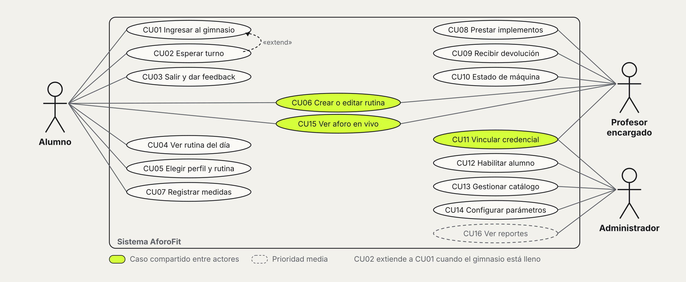
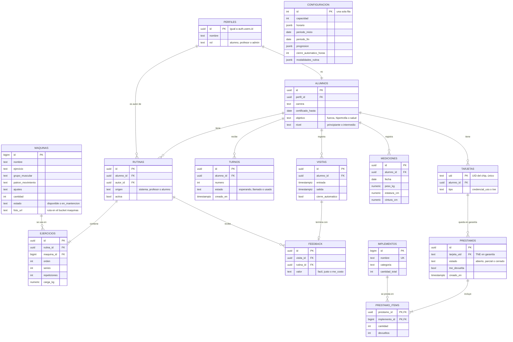
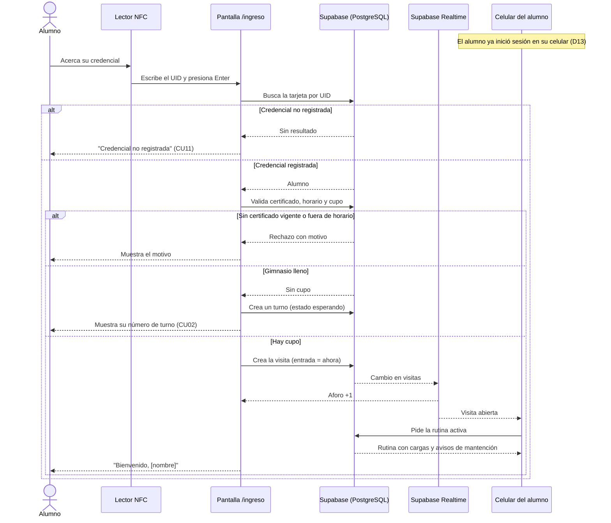
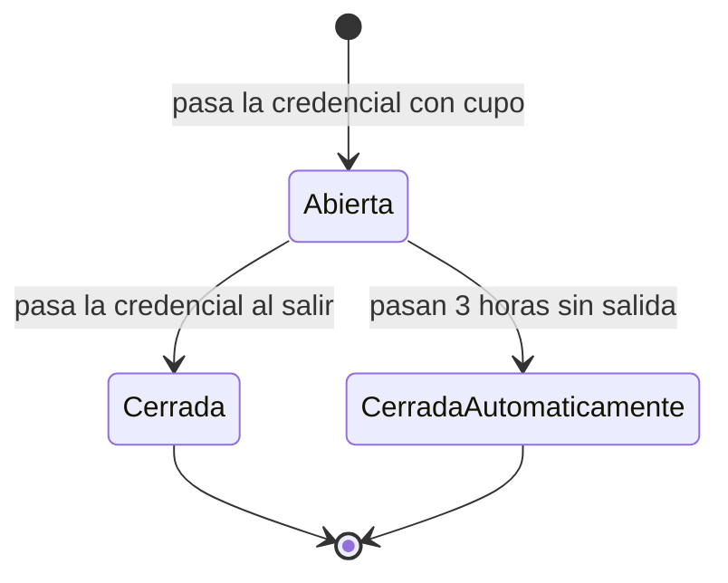
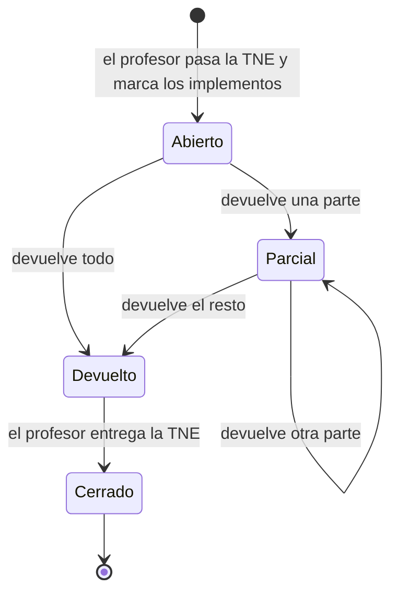

# AforoFit — Diagramas de análisis y diseño

Grupo 6 · Taller de Ingeniería de Software · Avance 2 · Actualizado el 16 de noviembre de 2026

Este documento reúne los diagramas formales del sistema. Se basa en [`AGENTS.md`](../AGENTS.md), en los
[requisitos, casos de uso y criterios](requisitos-casos-uso-criterios.md) y en la
[revisión del prototipo](revision-prototipo-2026-11-16.md). Los diagramas en Mermaid se ven directamente en GitHub.

## Trazabilidad del diseño

Los diagramas describen el **diseño del Avance 2**. Los ID se desarrollan en el [registro de decisiones](../AGENTS.md#decisiones-vigentes-d01d17) y la [matriz de requisitos y criterios](requisitos-casos-uso-criterios.md#8-matriz-de-cobertura).

| Vista | Qué cubre | Trazabilidad principal |
|---|---|---|
| [Casos de uso](#1-casos-de-uso) | Actores, funciones y alcance de CU01–CU16 | [Especificaciones de los casos](requisitos-casos-uso-criterios.md#5-especificación-de-los-casos-de-uso-principales) |
| [Modelo entidad-relación](#2-modelo-entidad-relación) | Datos de acceso, visitas, turnos, rutinas, catálogo, préstamos, mediciones y configuración | RF02, RF04, RF06–RF08, RF10–RF15, RF18–RF27 |
| [Secuencia del ingreso](#3-secuencia-del-ingreso-cu01-cu02-y-cu04) | Lectura, validación, entrada o turno, aforo y rutina | CU01, CU02, CU04, CU11 y CU15 · CA01–CA07, CA10–CA13, CA29 y CA31 |
| [Estados de la visita](#4-estados-de-la-visita) | Salida, cierre automático y liberación del cupo | CU03 y CU15 · CA08–CA11, CA14 y CA15 |
| [Estados del préstamo](#5-estados-del-préstamo) | Préstamo, devolución parcial y devolución de garantía | CU08 y CU09 · CA19–CA21 y CA27 |
| [Flujo central](diagramas/flujo-central.svg), [arquitectura](diagramas/arquitectura.svg) e [interfaces en la PPT](entregas/avances/AforoFit-Avance2-Grupo6.pdf) | Recorrido del alumno, componentes, despliegue y vistas de los roles | [Flujo central](../AGENTS.md#5-flujo-central-lo-que-se-demuestra-en-vivo), [stack](../AGENTS.md#6-stack-y-arquitectura) y RNF01–RNF11 |

## Estado

| Diagrama | Herramienta | Archivo | Estado |
|---|---|---|---|
| Casos de uso | draw.io | [`diagramas/casos-de-uso.drawio`](diagramas/casos-de-uso.drawio) | Listo |
| Entidad-relación | draw.io y Mermaid (este archivo) | [`diagramas/entidad-relacion.drawio`](diagramas/entidad-relacion.drawio) | Propuesta, se ajusta al crear las tablas |
| Secuencia del ingreso | Mermaid (este archivo; draw.io lo importa con Organizar → Insertar → Mermaid) | — | Listo |
| Estados de la visita y del préstamo | draw.io y Mermaid (este archivo) | [`diagramas/estados.drawio`](diagramas/estados.drawio) | Listo |
| Flujo central y arquitectura | Imágenes de la presentación | [`diagramas/`](diagramas/) | Listo |

Para editar el diagrama de casos de uso, abre el archivo `.drawio` en [app.diagrams.net](https://app.diagrams.net)
(Archivo → Abrir desde → Dispositivo).

---

## 1. Casos de uso

Tres actores y 16 casos de uso. El alumno concentra el flujo central (CU01 a CU04).

| Caso | Nombre | Actores | Prioridad |
|---|---|---|---|
| CU01 | Ingresar al gimnasio | Alumno | Alta |
| CU02 | Esperar turno (extiende CU01) | Alumno | Alta |
| CU03 | Salir y dar feedback | Alumno | Alta |
| CU04 | Ver rutina del día | Alumno | Alta |
| CU05 | Elegir perfil y rutina | Alumno | Alta |
| CU06 | Crear o editar rutina | Alumno, profesor | Alta |
| CU07 | Registrar medidas | Alumno | Alta |
| CU08 | Prestar implementos | Profesor | Alta |
| CU09 | Recibir devolución | Profesor | Alta |
| CU10 | Cambiar estado de máquina | Profesor | Alta |
| CU11 | Vincular credencial (extiende CU01) | Profesor, administrador | Alta |
| CU12 | Habilitar alumno | Administrador | Alta |
| CU13 | Gestionar catálogo | Administrador | Alta |
| CU14 | Configurar parámetros | Administrador | Alta |
| CU15 | Ver aforo en vivo | Alumno, profesor | Alta |
| CU16 | Ver reportes | Administrador | Media |

**Relaciones:**
- CU02 extiende CU01 cuando el gimnasio está lleno.
- CU11 extiende CU01 cuando la credencial no está registrada.

**Casos compartidos:** CU06, CU11 y CU15 usan la misma pantalla, con permisos distintos según el rol.

---

## 2. Modelo entidad-relación

Catorce tablas. El alumno es el centro: tiene tarjetas, visitas, turnos, rutinas y mediciones. Todas las tablas
tienen RLS activado.

**Reglas que se aplican en la base de datos:**
- `tarjetas.uid` es único: una credencial pertenece a un solo alumno (regla 1).
- Índice único parcial en `visitas (alumno_id) where salida is null`: una visita abierta por alumno (regla 5).
- `prestamo_items.devueltos <= cantidad`.
- RLS en `mediciones`: solo las lee su dueño (RNF07).

---

## 3. Secuencia del ingreso (CU01, CU02 y CU04)

La validación de certificado, horario y cupo debería quedar en una sola función de la base de datos, para que
dos lecturas al mismo tiempo no ocupen el último cupo.

---

## 4. Estados de la visita

| Estado | Cómo se guarda | Efecto |
|---|---|---|
| Abierta | `salida` vacía | Cuenta en el aforo |
| Cerrada | `salida` con la hora real | Libera el cupo y pide feedback si usó su rutina |
| Cerrada automáticamente | `salida` con la hora del cierre y `cierre_automatico = true` | Libera el cupo y no pide feedback |

---

## 5. Estados del préstamo

| Estado | Condición | Puede abrir otro préstamo |
|---|---|---|
| Abierto | Ningún implemento devuelto | No |
| Parcial | Algunos implementos devueltos | No |
| Devuelto | Todo devuelto y la TNE sigue con el profesor | No |
| Cerrado | Todo devuelto y `tne_devuelta = true` | Sí |

Los préstamos no cambian el aforo (D04).

---

## Pendientes

- Contrastar el modelo entidad-relación con los [scripts de perfiles y catálogo](../supabase/sql/) ya disponibles y actualizarlo a medida que se creen las tablas del flujo central.
- Definir qué pasa con un turno llamado que no se presenta (por ejemplo, si vence a los 5 minutos).
