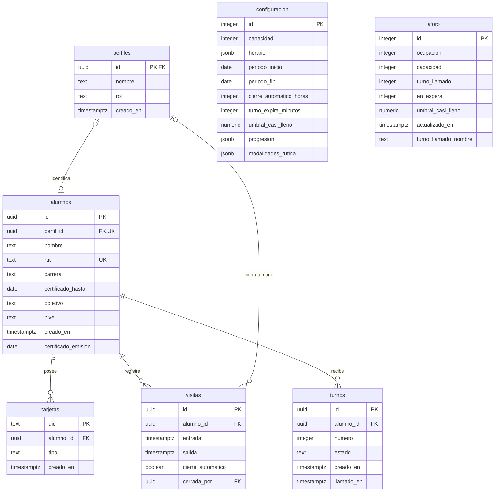
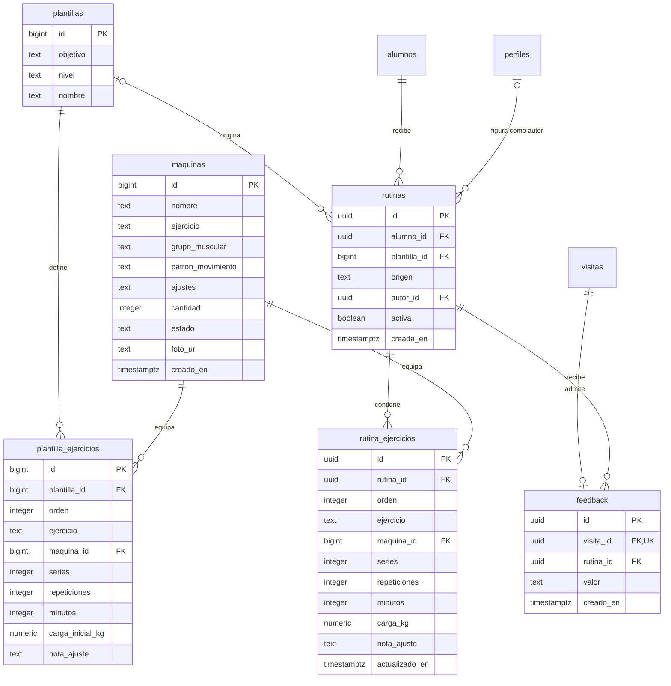
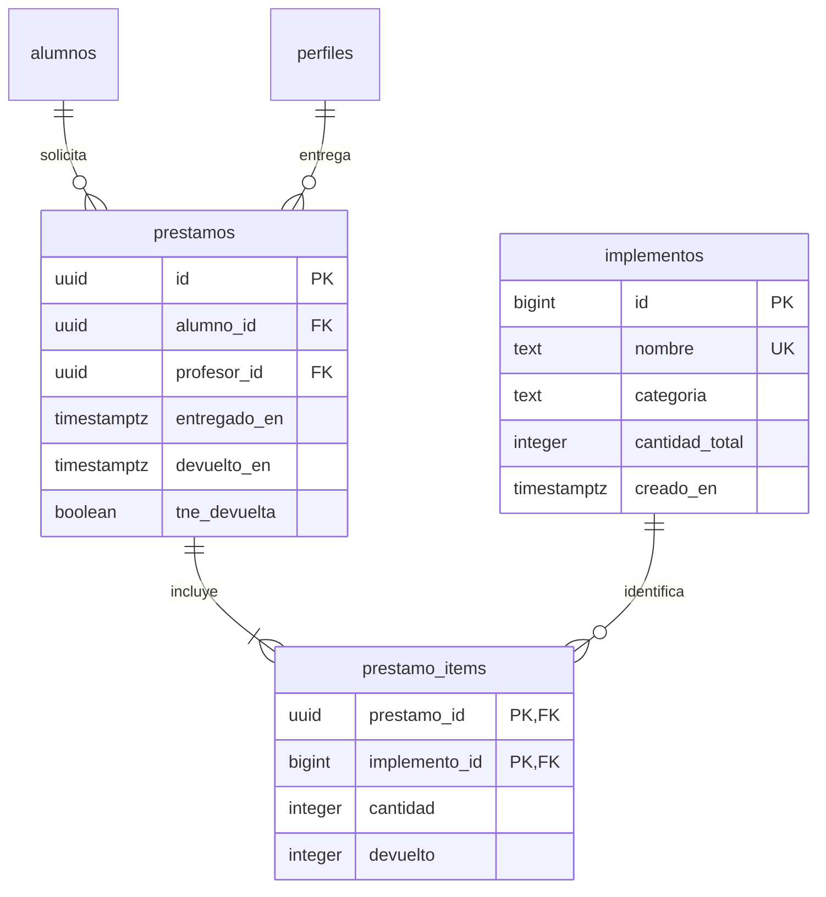
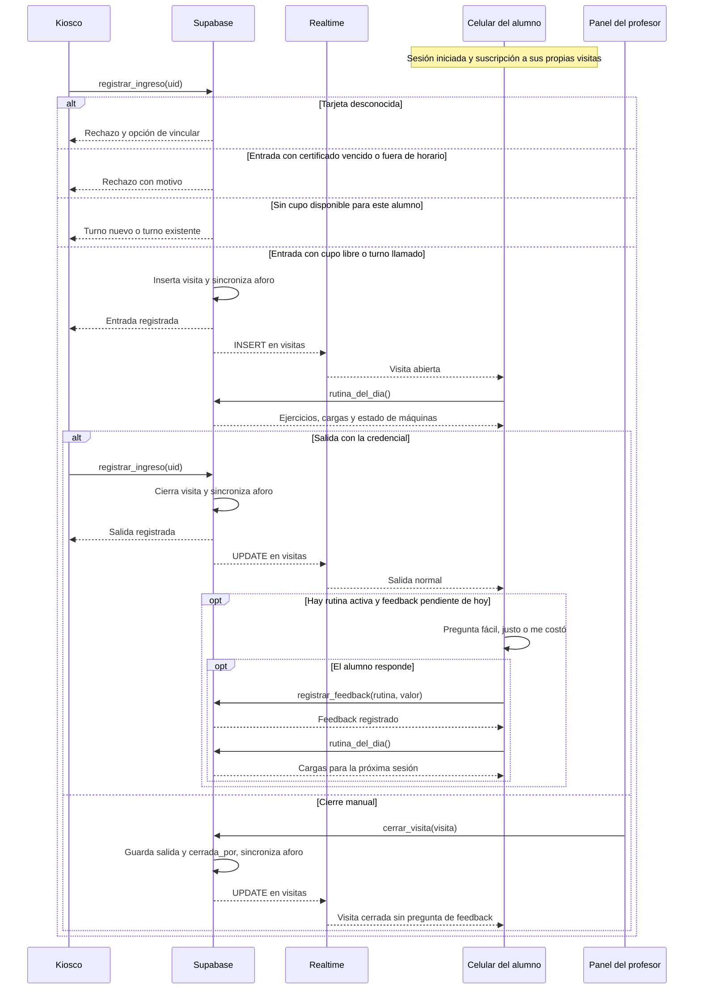
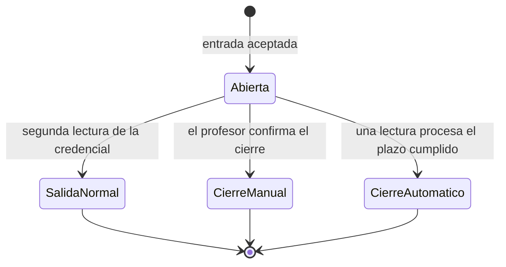
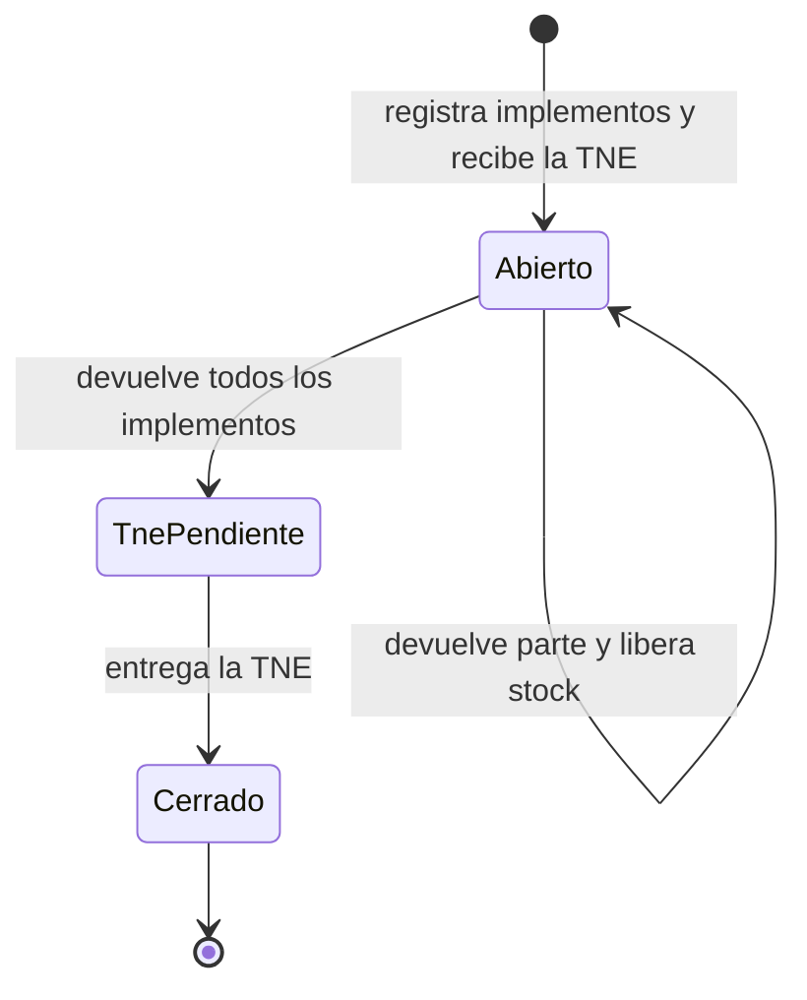

# AforoFit — Diagramas de análisis y diseño

El documento maestro conserva los [diagramas y estados del Avance 2](cierre-avances-1-y-2.md#diagramas-completos).

Grupo 6 · Taller de Ingeniería de Software · Entrega final · Actualizado el 25 de noviembre de 2026

Este documento reúne los diagramas formales del sistema. Se basa en [`AGENTS.md`](../AGENTS.md), en los
[requisitos, casos de uso y criterios](requisitos-casos-uso-criterios.md) y en la
[revisión del prototipo](revision-prototipo-2026-11-16.md). Los diagramas en Mermaid se ven directamente en GitHub.

## Trazabilidad del diseño

Los casos de uso conservan el diseño del Avance 2. El modelo físico, la secuencia y los estados describen la implementación hasta 017 (sin 016). Los ID se desarrollan en el [registro de decisiones](../AGENTS.md) y la [matriz de requisitos y criterios](requisitos-casos-uso-criterios.md#8-matriz-de-cobertura).

| Vista | Qué cubre | Trazabilidad principal |
|---|---|---|
| [Casos de uso](#1-casos-de-uso) | Actores, funciones y alcance de CU01–CU16 | [Especificaciones de los casos](requisitos-casos-uso-criterios.md#5-especificación-de-los-casos-de-uso-principales) |
| [Modelo entidad-relación](#2-modelo-entidad-relación) | Acceso, visitas, turnos, rutinas, catálogo, préstamos y configuración | RF02, RF04, RF06–RF08, RF10–RF15, RF18–RF27 |
| [Secuencia del ingreso](#3-secuencia-del-ingreso-cu01-cu02-y-cu04) | Lectura, validación, entrada o turno, aforo y rutina | CU01, CU02, CU04, CU11 y CU15 · CA01–CA07, CA10–CA13, CA29 y CA31 |
| [Estados de la visita](#4-estados-de-la-visita) | Salida, cierres manual y automático y liberación del cupo | CU03 y CU15 · CA08–CA11, CA14 y CA15 |
| [Estados del préstamo](#5-estados-del-préstamo) | Préstamo básico, stock y devolución completa con la garantía | CU08 y CU09 · CA19 y CA20 (S1) |
| [Flujo central](diagramas/flujo-central.svg), [arquitectura](diagramas/arquitectura.svg) e [interfaces en la PPT](entregas/avances/AforoFit-Avance2-Grupo6.pdf) | Recorrido del alumno, componentes, despliegue y vistas de los roles | [Flujo central](../AGENTS.md#5-flujo-central-lo-que-se-demuestra-en-vivo), [stack](../AGENTS.md#6-stack-y-arquitectura) y RNF01–RNF11 |

## Estado

| Diagrama | Herramienta | Archivo | Estado |
|---|---|---|---|
| Casos de uso | draw.io | [`diagramas/casos-de-uso.drawio`](diagramas/casos-de-uso.drawio) | Listo |
| Entidad-relación | draw.io y Mermaid (este archivo) | [`diagramas/entidad-relacion.drawio`](diagramas/entidad-relacion.drawio) | Mermaid refleja las 16 tablas públicas hasta 017 y describe la tabla privada QR; draw.io conserva el diseño original |
| Secuencia del ingreso | Mermaid (este archivo; draw.io lo importa con Organizar → Insertar → Mermaid) | — | Incluye Realtime, feedback y cierre manual |
| Estados de la visita y del préstamo | draw.io y Mermaid (este archivo) | [`diagramas/estados.drawio`](diagramas/estados.drawio) | Mermaid refleja 012 y 017; draw.io conserva el diseño original |
| Flujo central y arquitectura | Imágenes de la presentación | [`diagramas/`](diagramas/) | Listo |

Para editar el diagrama de casos de uso, abre el archivo `.drawio` en [app.diagrams.net](https://app.diagrams.net)
(Archivo → Abrir desde → Dispositivo).

---

## 1. Casos de uso

Tres actores y 16 casos de uso. El alumno concentra el flujo central (CU01 a CU04).

| Caso | Nombre | Actores | Prioridad |
|---|---|---|---|
| CU01 | Ingresar al gimnasio | Alumno | Alta |
| CU02 | Esperar turno (extiende CU01) | Alumno | Alta |
| CU03 | Salir y dar feedback | Alumno | Alta |
| CU04 | Ver rutina del día | Alumno | Alta |
| CU05 | Elegir perfil y rutina | Alumno | Alta |
| CU06 | Crear o editar rutina | Alumno, profesor | Alta |
| CU07 | Registrar medidas | Alumno | Alta |
| CU08 | Prestar implementos | Profesor | Alta |
| CU09 | Recibir devolución | Profesor | Alta |
| CU10 | Cambiar estado de máquina | Profesor | Alta |
| CU11 | Vincular credencial (extiende CU01) | Profesor, administrador | Alta |
| CU12 | Habilitar alumno | Administrador | Alta |
| CU13 | Gestionar catálogo | Administrador | Alta |
| CU14 | Configurar parámetros | Administrador | Alta |
| CU15 | Ver aforo en vivo | Alumno, profesor | Alta |
| CU16 | Ver reportes | Administrador | Media |

**Relaciones:**
- CU02 extiende CU01 cuando el gimnasio está lleno.
- CU11 extiende CU01 cuando la credencial no está registrada.

CU11 se realiza en el kiosco con sesión de profesor o administrador. CU15 se consulta en la pantalla pública. CU06 pertenece al diseño de una próxima versión.

---

## 2. Modelo entidad-relación

El [modelo conceptual del Avance 2](diagramas/entidad-relacion.drawio) incluye el registro corporal y la devolución parcial. Para consultar la estructura que usa la aplicación, utiliza el modelo físico de abajo. La [captura del 23 de noviembre](diagramas/entidad-relacion-implementado.png) documenta el esquema anterior de nueve tablas.

### 2.1 Modelo implementado en Supabase (25 de noviembre de 2026)

Las migraciones 001–015 y 017 mantienen **16 tablas en `public`**, todas con RLS. 017 añade la tabla privada `privado.codigos_ingreso` con RLS para códigos de acceso de un solo uso. Las tres vistas del diagrama comparten las entidades que conectan los módulos. PK indica clave primaria, FK clave foránea y UK una columna única. Las dos columnas PK de `prestamo_items` forman una sola clave compuesta.

**Acceso, visitas y aforo.** El perfil usa como PK el mismo identificador que `auth.users.id` (FK a Supabase Auth). Un alumno puede tener varias tarjetas y como máximo una visita abierta. La vinculación a un perfil es opcional y única.

`configuracion` y `aforo` tienen una fila cada una (id 1). Sus valores se sincronizan por funciones. Los campos de período se conservan por historial; la habilitación depende de `certificado_hasta`. El número de turno es único por día de Santiago. La pantalla pública lee aforo y recibe solo el nombre abreviado junto al llamado.

**Rutinas y máquinas.** Cada combinación de objetivo y nivel identifica una plantilla. El orden de un ejercicio es único dentro de su plantilla o rutina. Solo puede haber una rutina activa por alumno y una respuesta de feedback por visita.

**Préstamos.** La cabecera identifica al alumno y al perfil que entrega los implementos. La TNE se recibe físicamente como garantía. La búsqueda por tarjeta es opcional y el préstamo es independiente de la visita.

`stock_prestamos` y `prestamos_pendientes` son vistas. El stock disponible se calcula restando las cantidades pendientes (`cantidad - devuelto`). Un índice único parcial impide tener dos solicitudes pendientes para el mismo alumno.

## 3. Secuencia del ingreso (CU01, CU02 y CU04)

El lector entrega el UID y Enter. El kiosco normaliza el código y hace una llamada a `registrar_ingreso`. La base bloquea la fila de aforo para ordenar las lecturas simultáneas, procesa cierres automáticos y turnos vencidos, e identifica la tarjeta. La salida de una visita abierta se procesa antes de validar certificado y horario. [Contrato del flujo de ingreso](contrato-flujo-ingreso.md)

El celular relee su rutina tras el cambio de visita. Si al alumno le falta objetivo o nivel, `/alumno` le ofrece elegirlos para generar la rutina. La pantalla pública escucha los cambios de `aforo`: cuando se libera un cupo, muestra el turno llamado y el nombre abreviado. El alumno llamado debe volver a pasar su credencial para entrar.

## 4. Estados de la visita

| Estado | Registro en visitas | Efecto |
|---|---|---|
| Abierta | `salida` nula | Cuenta en la ocupación. |
| Salida normal | `salida` registrada, `cerrada_por` nulo y `cierre_automatico = false` | Libera el cupo; ese día el celular ofrece feedback si corresponde. |
| Cierre manual | `salida` registrada, `cerrada_por` identifica al responsable | Libera el cupo sin pedir feedback. |
| Cierre automático | `salida = entrada + plazo`, `cierre_automatico = true` | Libera el cupo sin pedir feedback. El plazo inicial es de tres horas y se comprueba al procesar una lectura. |

## 5. Estados del préstamo

| Estado en 017 | Registro en préstamos | Efecto |
|---|---|---|
| Abierto | `devuelto_en` nulo y `tne_devuelta = false` | Descuenta stock y bloquea otra solicitud del alumno. |
| TNE pendiente | `devuelto_en` registrado y `tne_devuelta = false` | Todo el stock repuesto; sigue bloqueado otro préstamo. |
| Cerrado | `devuelto_en` registrado y `tne_devuelta = true` | Permite solicitar otro préstamo. |

`registrar_devolucion(uuid,jsonb)` devuelve cantidades o todo lo pendiente con NULL; `entregar_tne(uuid)` cierra la garantía. La firma `registrar_devolucion(uuid)` mantiene el contrato 015: devuelve todo y entrega la TNE en una transacción. D19 bloquea otro préstamo hasta que ambos procesos estén completos. Ninguna de estas operaciones modifica el aforo (D04).

## Pendientes

- Isidora revisa el modelo y los flujos contra 017 antes de dar por cerrado F-13.
- F-20, F-27 y F-21 fusionados en PR #21; F-33 en PR #20. El registro corporal y la creación de rutinas por profesor o alumno siguen en el diseño de la próxima versión.
- Para el ensayo, comprobar con el lector físico y el celular el ciclo entrada, salida y feedback. Los turnos llamados sin reclamar expiran cuando una nueva lectura procesa el plazo configurado.

### Complemento: respaldo QR e historial (017 y F-33)

El alumno genera un código de seis caracteres con vencimiento de dos minutos. La tabla privada `codigos_ingreso` guarda alumno, código único y vencimiento; el profesor canjea el código mediante `registrar_ingreso_codigo`, que consume el código y usa las mismas reglas de entrada/salida que la credencial. La cámara es opcional según navegador; se puede escribir el código. F-33 usa las tablas existentes y las políticas por rol, sin migración adicional. Los diagramas draw.io conservan el diseño histórico; los cambios de implementación se reflejan en Mermaid y este complemento.
