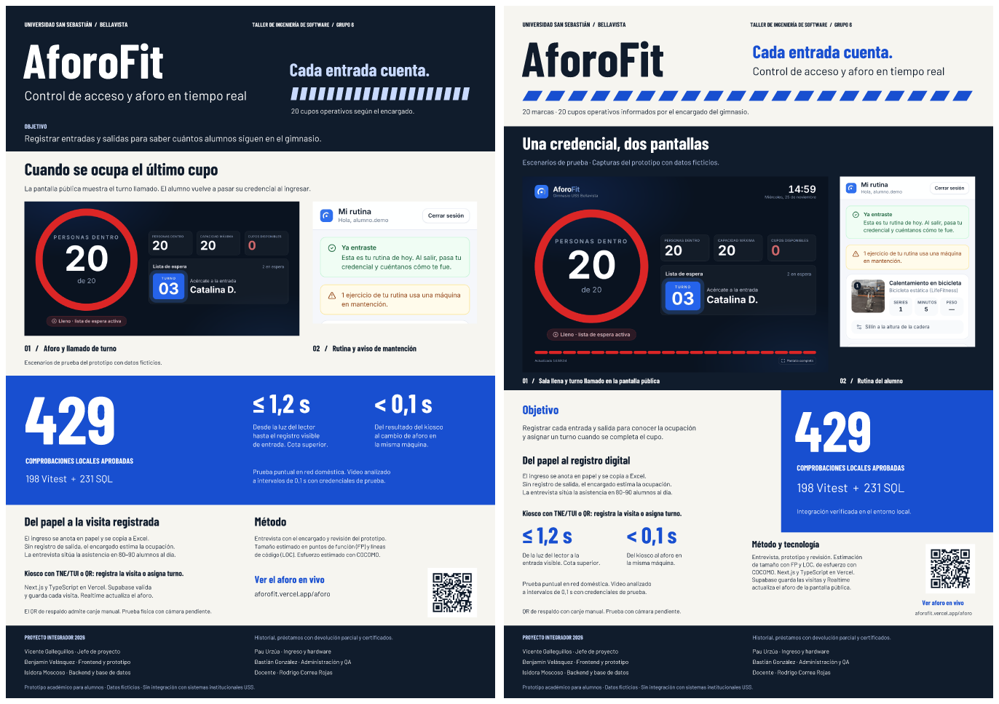

# AforoFit · Segunda iteración del afiche



**Recomendación para la defensa: B3.** En la pantalla pública se ve la sala llena, el turno 03 y dos alumnos en espera. Al lado se leen la confirmación de entrada, el aviso de mantención y el primer ejercicio de la rutina. El expositor puede explicar ambas respuestas del sistema señalando el afiche. B2 dedica más espacio a comparar las mediciones y a explicar las condiciones de la prueba.

| Pieza | PDF A0 | PNG | SVG editable |
|---|---|---|---|
| B2 · Equilibrio editorial | [Abrir](B2.pdf) | [Ver](B2.png) | [Editar](B2.svg) |
| B3 · Producto y evidencia | [Abrir](B3.pdf) | [Ver](B3.png) | [Editar](B3.svg) |

## Decisiones de composición

Las dos piezas recuperan «Cada entrada cuenta» y veinte marcas, una por cupo operativo informado en la entrevista. AforoFit ocupa la primera escala de lectura. El descriptor explica el producto y la cifra 20 aparece en contexto. En B2 la cabecera ocupa el 21 % de la altura; en B3, el 17 %. Se reservaron 70 × 33 mm en la cabecera para un eventual logo USS autorizado. En el SVG, el objeto invisible tiene el identificador `reserva-logo-USS-autorizado`.

B2 acerca el laboratorio al visitante: una banda azul reúne el total de pruebas, el desglose y dos intervalos de tiempo. B3 sitúa la demostración inmediatamente bajo la marca y deja una columna para las 429 comprobaciones. Barlow Condensed Bold da peso a titulares y números; Barlow Regular facilita la lectura de frases y pies. Los textos, las marcas y el QR son vectoriales. Los colores editoriales se mantienen planos; las capturas conservan los colores del producto.

## Evidencia y bases

| Contenido exigido | Tratamiento en ambas piezas |
|---|---|
| Identificación | Universidad, sede, asignatura y grupo en la cabecera. Año, cinco integrantes con roles y docente en el pie. |
| Problema y objetivo | Papel y posterior transcripción a Excel, salidas sin registrar y 80–90 asistentes diarios estimados por el encargado. Objetivo explícito de registrar visitas y conocer la ocupación. |
| Método, tecnologías y arquitectura | Entrevista y revisión del prototipo. Estimación de tamaño con FP y LOC, y de esfuerzo mediante COCOMO. El kiosco recibe TNE/TUI o QR. Supabase guarda la visita y Realtime actualiza la pantalla. Next.js, TypeScript y Vercel completan el esquema. |
| Funciones, beneficio y conclusión | El registro deja ver la ocupación, permite llamar turnos y activa la rutina. El panel del alumno muestra la advertencia de mantención. Se identifican historial, préstamos con devolución parcial y certificados. |
| Evidencia y límites | Las dos capturas están rotuladas como escenarios de prueba. Prototipo académico para alumnos, datos ficticios y sin integración USS. Canje QR manual disponible; la prueba física con cámara sigue pendiente. |
| Resultados | 198 Vitest + 231 SQL = 429 comprobaciones automatizadas locales aprobadas. En la prueba física, ≤ 1,2 s hasta la entrada visible es una cota superior. El cambio de aforo ocurrió en menos de 0,1 s desde el resultado del kiosco, en la misma máquina. Prueba puntual en red doméstica, mediante video a intervalos de 0,1 s. |

Fuentes del proyecto: [bases, especialmente §§7–9](../../bases-proyecto-integrador.md), [estimación](../../estimacion.md), [pruebas ejecutadas](../../pruebas-ejecutadas.md), [medición con lector](../../medicion-ca29-2026-11-23.md) y [entrevista](../../entrevista-encargado-2026-11-12.md). La aprobación, impresión, montaje y defensa corresponden a hitos posteriores.

## Revisión técnica

Se inspeccionaron las dos páginas renderizadas, su composición a igual escala y las imágenes de origen. Se comprobó en las instrucciones del PDF la caja de página de 841 × 1189 mm, la presencia de los dos archivos tipográficos incrustados y los píxeles RGB de cada recorte. El QR de 85 mm lleva cuatro módulos de zona blanca por lado y conserva un margen exterior derecho de 32 mm. Ambos renderizados se decodificaron a **https://aforofit.vercel.app/aforo**. La dirección escrita permite el acceso manual. Esta comprobación corresponde al QR impreso del afiche; el QR del alumno cumple otra función.

| Variante | Imagen de aforo | Panel del alumno | Resolución efectiva respectiva |
|---|---|---|---|
| B2 | Recorte de 1280 × 625 px a 472 mm de ancho | Recorte de 720 × 535 px a 282 mm | 68,9 y 64,9 ppp |
| B3 | Vista completa de 1280 × 820 px a 525 mm | Recorte de 720 × 908 px a 232 mm | 61,9 y 78,8 ppp |

Las capturas se tomaron de [fidelidad](../../evidencia/fidelidad/). El recorte selecciona información existente y conserva las proporciones. En A0, los números y los mensajes centrales se distinguen mejor que las leyendas mínimas de la interfaz. Para conseguir mayor definición conviene recapturar el mismo escenario a doble densidad de píxeles y conservar el encuadre. Aún falta comprobar lectura a 3–5 metros, nitidez, color y escaneo con una prueba física. Confirmar soporte, perfil, sangrado y montaje con la imprenta.

Contraste de luminancia de los pares editoriales: blanco sobre azul 6,84:1; tinta sobre marfil 15,71:1; azul sobre marfil 6,27:1; azul claro sobre tinta 12,21:1. La revisión digital incluyó los extremos de los textos, la alineación de las capturas, sus pies, la separación del QR y la lectura de las cifras con sus condiciones.

## Evaluación editorial interna

La auditoría independiente de **87/100** corresponde a la B original. Esta tabla expresa el juicio editorial de la segunda iteración, pendiente de evaluación externa.

| Criterio | B2 | B3 | Evidencia |
|---|---:|---:|---|
| Identidad y originalidad /15 | 14 | 14 | Las veinte marcas adquieren función de escala. En B3 también separan la marca de la demostración. |
| Impacto a distancia /15 | 13 | 14 | En la reducción se distinguen AforoFit y 429 en ambas piezas; B3 añade el conteo circular. Falta prueba física. |
| Jerarquía y legibilidad /15 | 14 | 13 | B2 mantiene juntos los intervalos y condiciones. B3 reserva más altura a las pantallas y comprime el método. |
| Cumplimiento académico del contenido /20 | 19 | 19 | Objetivo, estimación, tecnologías, evidencia, límites y equipo visibles. La secuencia técnica se expresa en texto breve. |
| Evidencia y precisión /15 | 14 | 15 | B2 hace legibles los estados; B3 conserva la pantalla pública completa y muestra además el primer ejercicio. |
| Coherencia y adaptación /10 | 9 | 9 | La señalética deportiva y las pantallas auténticas mantienen continuidad con el producto. |
| Calidad técnica de impresión /10 | 8 | 8 | PDF vectorial, fuentes incrustadas y QR verificado. La definición de las capturas y la prueba física limitan el puntaje. |
| **Total /100** | **91** | **92** | Selección y aprobación a cargo del jefe de proyecto. |

## Editar y regenerar

Los SVG son autónomos. Se pueden abrir en Inkscape e instalar las dos tipografías de la carpeta `fuentes` para conservar sus métricas. Los textos siguen siendo editables. La reserva USS está vacía. Para conservar los cambios al regenerar, modificar `compose()` en [componer.cjs](componer.cjs). Las cajas de recorte usan origen superior izquierdo y están expresadas como x, y, ancho, alto en píxeles.

Para regenerar únicamente esta iteración desde esta carpeta, usar Node.js, npm y Poppler (`pdftoppm` en el PATH):

```sh
npm install --no-save --package-lock=false --prefix /tmp/aforofit-expo opentype.js@1.3.4 pngjs@7.0.0
NODE_PATH=/tmp/aforofit-expo/node_modules node componer.cjs
```

El generador lee las capturas del repositorio y la matriz QR de la B original. Escribe B2/B3 en SVG, PDF y PNG y la comparativa. Las vistas PNG pueden variar ligeramente según el suavizado del rasterizador. Las fuentes incluidas conservan sus licencias SIL Open Font License en `fuentes/`.
